# Nigeria Flood Risk Mapper

**Satellite water segmentation → flood susceptibility → rainfall-driven risk.**

An applied machine learning project combining Sentinel-1 radar imagery, geospatial features, and rainfall data to map flood risk across Nigeria. The planned application will provide historical flood maps, exposure estimates, and experimental 72-hour risk assessments for Nigeria’s 774 Local Government Areas (LGAs).

**Current release.** The historical map package contains eight dated radar observations, downloadable map tiles and an LGA lookup table. A research terrain model has spatial and event-based evaluations. A national rainfall batch covers 774 LGAs. The 72-hour flood warning model still needs time-matched outcome evidence. [Pre-app status](PRE_APP_STATUS.md)

[Results](#results) · [Approach](#approach) · [Getting started](#getting-started) · [Roadmap](#roadmap)

## Results

### M1-S1: completed training run

| Validation metric | Best checkpoint selection epoch |
|---|---:|
| Water IoU | **0.6895** |
| Mean IoU — water and dry | **0.8227** |
| Epoch | **49 / 60** |

The best epoch is selected by validation water IoU. Values come from the downloaded training history and are rounded to four decimal places. The checkpoint is available locally as `best.pt`; it has been loaded successfully and evaluated on both held-out splits.

[Training record](reports/m1-s1-kaggle-365653491/README.md) · [Epoch history](reports/m1-s1-kaggle-365653491/history.csv) · [Artifact summary](reports/m1-s1-kaggle-365653491/summary.json)

### Held-out benchmarks

| Method | Test water IoU | Test mIoU | Bolivia water IoU | Bolivia mIoU |
|---|---:|---:|---:|---:|
| Provided Sentinel-1 Otsu masks | 0.546 | 0.731 | 0.697 | 0.814 |
| U-Net / ResNet-34 · threshold 0.50 | 0.6973 | 0.8236 | 0.6908 | 0.8087 |
| U-Net / ResNet-34 · validation-selected 0.55 | **0.6985** | **0.8245** | 0.6935 | 0.8108 |

All scores use a 0–1 scale. Intersections and unions are pooled across the complete split, with no-data labels (`-1`) excluded. mIoU averages water and dry-class IoU. Bolivia is a separate geographic holdout. Otsu results are preserved in the [exploration notebook](notebooks/01_explore/01-explore-sen1floods11.ipynb).

At the original threshold 0.50, U-Net improves test water IoU by approximately **15.1 percentage points** over the recorded Otsu baseline and is approximately **0.6 points lower** on Bolivia. The validation-selected threshold 0.55 gives a small gain on both splits, but Bolivia still falls below Otsu. Baseline scores are rounded to three decimal places.

[Full evaluation report](reports/m1-s1-kaggle-365653491/evaluation.json) · 90 test chips · 15 Bolivia chips · CPU inference · threshold > 0.5

The threshold 0.55 was selected using validation data and frozen before its held-out evaluation; its report is linked in the threshold experiment below. Test/Bolivia had already been inspected for diagnosis, so this is not an evaluation on a fresh untouched dataset. Validation scores are reported separately from held-out scores. M1 measures water segmentation at image acquisition time. The country breakdown follows below.

### Optical comparison on Kaggle

The four-band Sentinel-2 U-Net completed 60 epochs. At threshold 0.50 it scored **0.8171 water IoU** on the official test split and **0.8033** on Bolivia. These scores use valid optical inputs and human labels. Radar remains the input for the historical hotspot maps because it can observe the surface through cloud cover. [Optical model card and training record](reports/m1-s2-kaggle-v2/README.md)

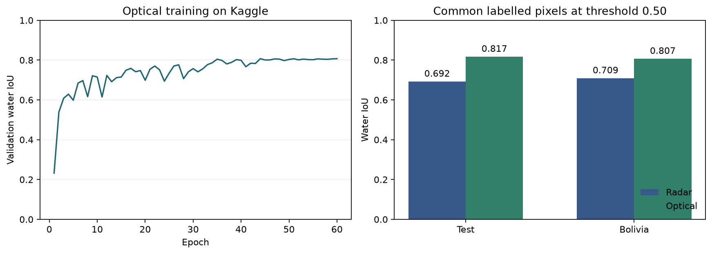

*The left panel traces 60 training epochs. The right panel compares the two models on identical valid pixels at threshold 0.50. On the 90 test chips, optical achieved 0.8172 water IoU and radar 0.6923. On the 15 Bolivia chips the scores were 0.8067 and 0.7091.* [Matched-pixel evaluation](reports/m1-s2-kaggle-v2/paired_evaluation.json)

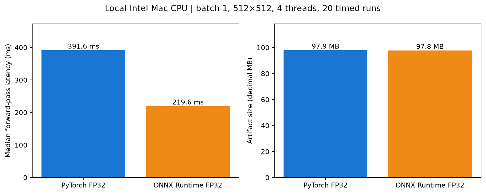

*The FP32 optical export took 220 ms per chip on the measured Intel CPU, compared with 392 ms for PyTorch. Across 89 validation chips, one of 23,330,816 pixel classifications differed. Dynamic INT8 conversion produced a graph whose convolution operator this CPU runtime could not execute.* [Export benchmark](reports/m1-s2-kaggle-v2/onnx_fp32/benchmark.json) · [INT8 compatibility check](reports/m1-s2-kaggle-v2/dynamic_int8.json)

### Nigerian chips in the official test split

Four test chips come from Nigeria. At the frozen 0.55 threshold, U-Net scored **0.8827 water IoU** and Otsu scored **0.8274**. IoU measures the overlap between predicted and labelled water divided by their combined area. Nigeria also contributed ten training chips and four validation chips. With only four test chips, the result gives little evidence about performance in a different city or flood season.

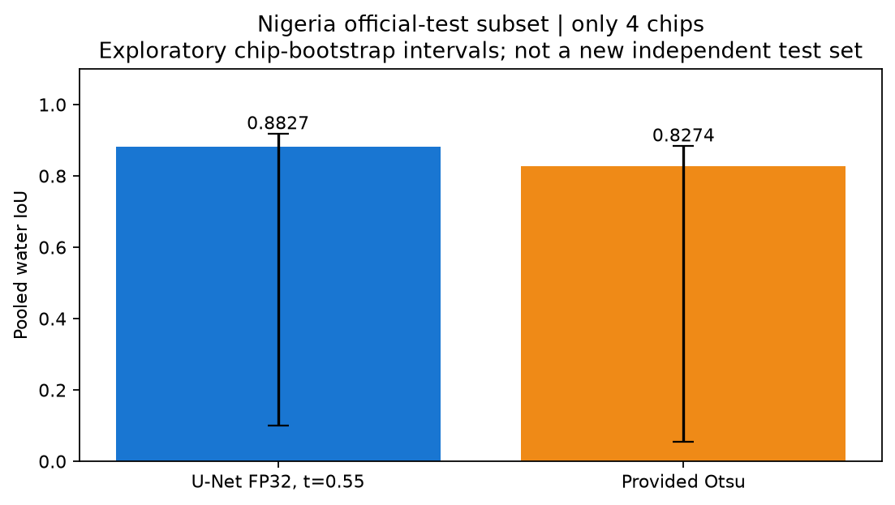

*Bars show pooled overlap. Whiskers show the middle 95% of 10,000 chip bootstrap results. Resampling entire chips exposes how much the answer depends on which scenes are included.* [Chip counts and results](reports/m1-s1-kaggle-365653491/nigeria_subset/summary.json)

### CPU precision experiment

The INT8 export reduced model size from **97.7 MB to 24.7 MB**. Water IoU across 89 validation chips changed from 0.68975 to 0.68901. On this Intel Mac the smaller model took **211 ms** per chip versus **179 ms** for FP32. FP32 remains the default because it met the latency objective better on the measured host.

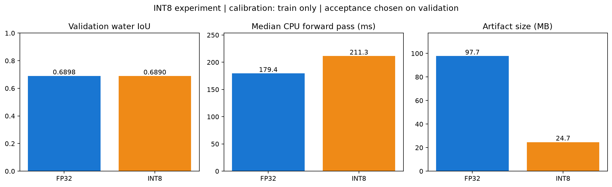

*The same chip, CPU thread count and alternating inference order were used for both timings. The static INT8 calibration used 32 training chips. The deployment host will need its own timing measurement.* [Benchmark details](reports/m1-s1-kaggle-365653491/int8_experiment/quantization.json)

## Inspect model predictions

Open [the local diagnostics notebook](notebooks/03_evaluate/03-prediction-diagnostics.ipynb) to compare radar input, human labels, predictions, and error maps. It reproduces the held-out scores, saves per-chip metrics, and selects low-, middle-, and high-IoU examples using a fixed rule. Examples are for diagnosis, not for tuning against the test set. [View the visual error analysis](reports/m1-s1-kaggle-365653491/diagnostics/README.md).

The audit found one test chip with entirely missing radar input and only water in its valid labels. Its perfect per-chip IoU is not meaningful evidence of radar interpretation. The published protocol ignores no-data labels but does not additionally mask missing inputs; this limitation is retained explicitly.

### Dataset examples

The first four training chips: VV and VH radar bands alongside human labels. These illustrate the input and target data, not model predictions. The label colour scale runs from no-data (-1) through dry (0) to water (1).

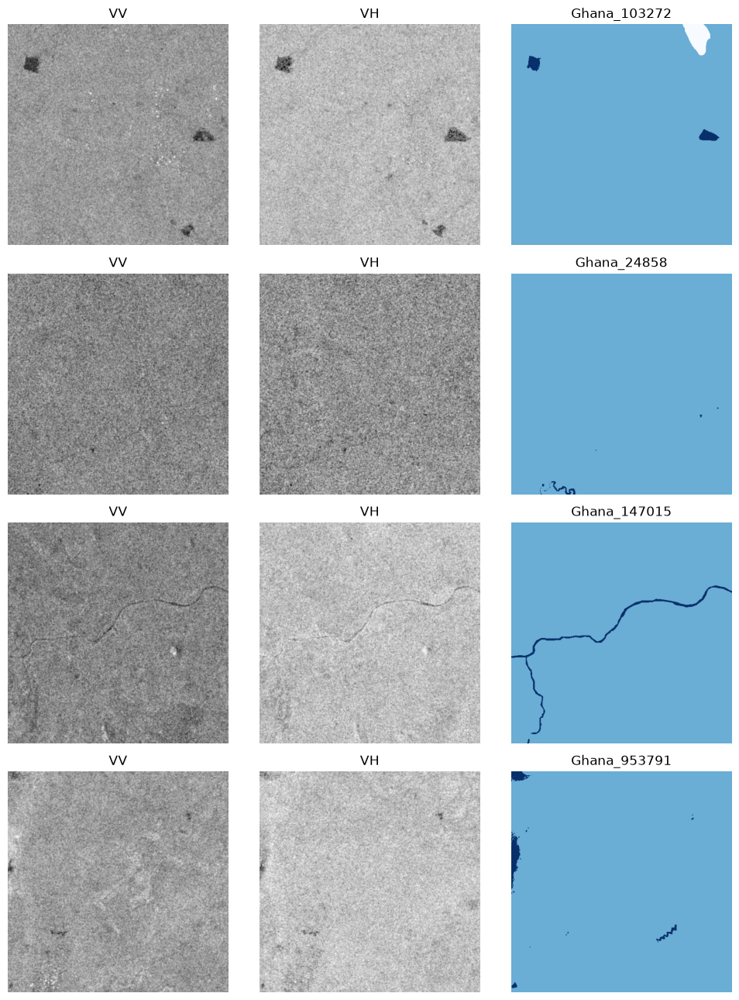

### Test predictions

Lowest-, middle-, and highest-ranked examples among chips with labelled water. Blue indicates correct water, red false alarms, orange missed water, and grey ignored labels. The highest-ranked example has entirely missing radar input; its perfect score is not meaningful evidence of radar interpretation.

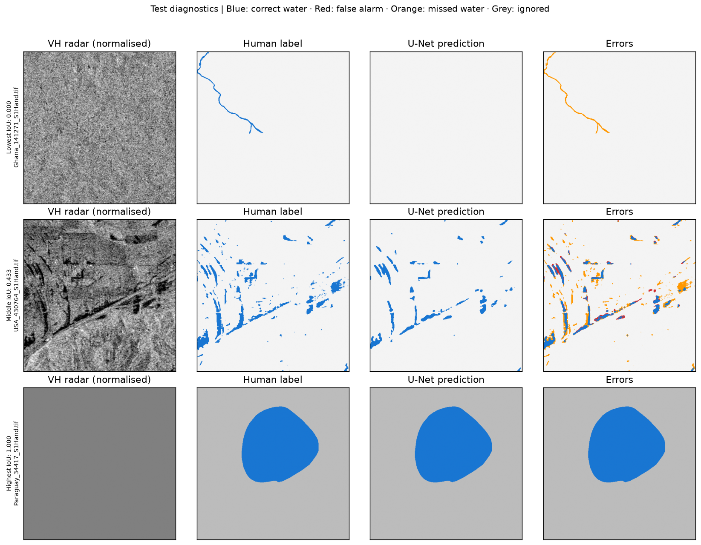

### Bolivia predictions

The same selection rule on the geographic holdout. The lowest-ranked example has only one labelled water pixel, making its per-chip IoU fragile. These selected examples are diagnostic, not representative samples.

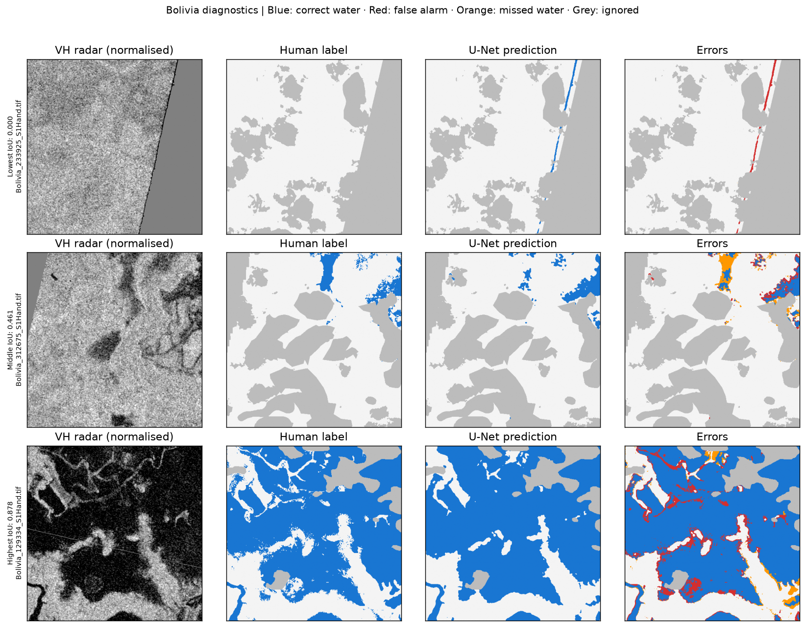

All project plots are saved under `reports/` and embedded in this README. Notebook plotting cells save the figures when rerun.

## Validation audit

A fixed-checkpoint audit across **89 validation chips** measured **0.6894 water IoU**, **82.46% precision**, and **80.79% recall**. Excluding non-finite radar inputs changes IoU to **0.6912**; those inputs overlap approximately **0.10%** of valid label pixels. The same scoring masks are applied to U-Net and Otsu. This is a sensitivity analysis of the evaluation policy, not a newly trained model or an independent test.

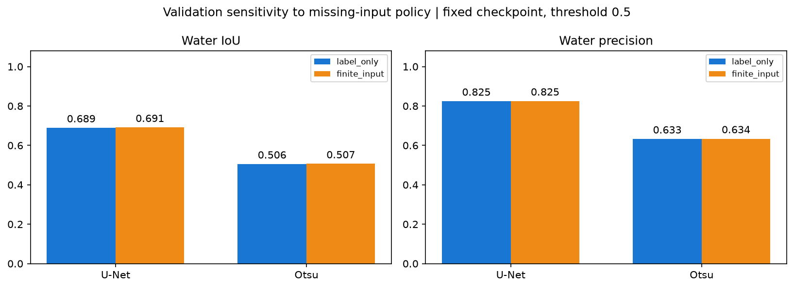

The original protocol ignores unlabelled pixels. The finite-input policy additionally excludes pixels with missing or infinite radar values. The small difference suggests this issue does not explain most validation errors.

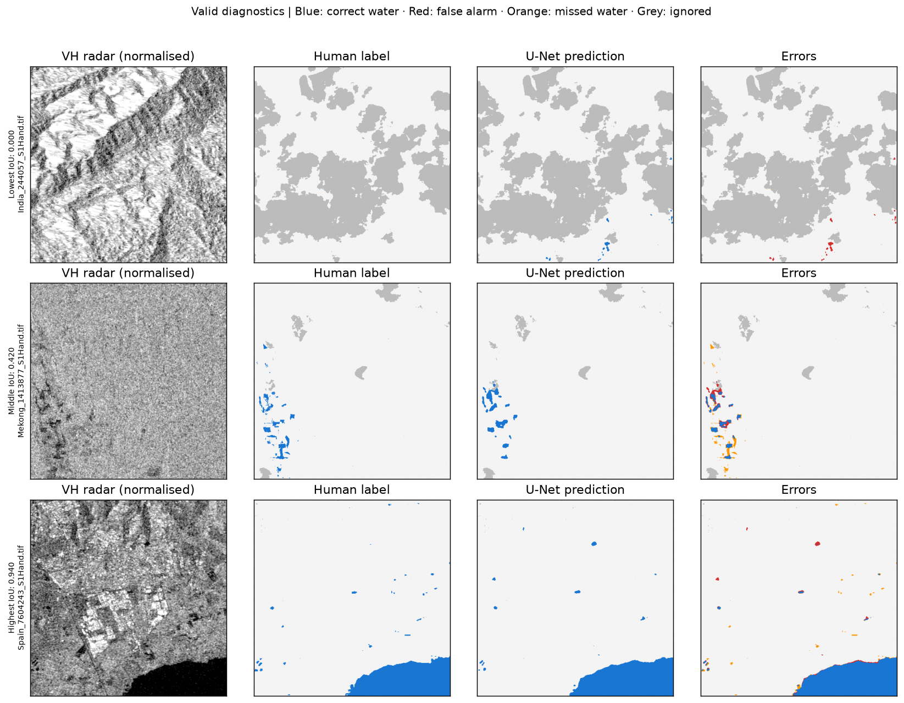

Lowest-, middle-, and highest-ranked examples among chips with labelled water. Red marks false alarms, orange missed water, blue correct water, and grey ignored labels. Sparse positive labels can make a chip's IoU fragile; these examples are not representative samples.

[Full validation audit](reports/m1-s1-kaggle-365653491/validation_audit/README.md) · [Reproducible notebook](notebooks/04_validation/04-validation-audit.ipynb)

## Threshold selection experiment

We tested thresholds **0.10–0.90 in steps of 0.05** on validation data, using maximum pooled water IoU as the predefined objective. The checkpoint and label-only mask were fixed. Ties favour the threshold closest to 0.50, then the smaller threshold.

Validation selected **0.55**: water IoU changed from **0.68944 to 0.68975** (approximately **+0.03 percentage points**). Precision rose from **82.46% to 83.18%**, while recall fell from **80.79% to 80.16%**. This is a small trade-off, not a substantial accuracy gain.

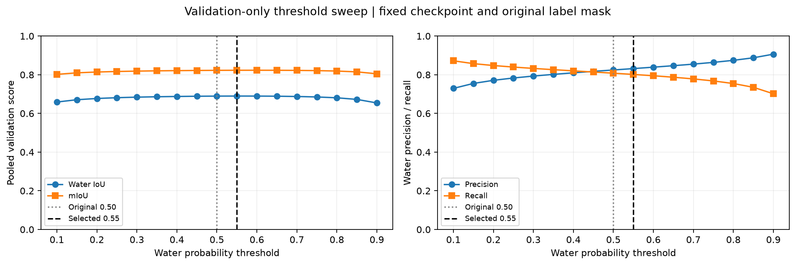

After freezing 0.55, test water IoU reached **0.6985** and Bolivia **0.6935**. The gains are small and Bolivia remains below Otsu. Both configurations are retained in the headline table.

Higher thresholds require stronger water scores, reducing predicted water coverage. The broad, nearly flat IoU curve indicates limited benefit from threshold adjustment alone. Model scores have not been established as calibrated probabilities.

[Threshold experiment](reports/m1-s1-kaggle-365653491/threshold_sweep/README.md) · [Selection configuration](reports/m1-s1-kaggle-365653491/threshold_sweep/selected_config.json) · [Notebook](notebooks/05_threshold/05-validation-threshold.ipynb)

## CPU deployment: verified FP32 ONNX export

The selected model exports to **ONNX opset 17** with fixed input shape `1 × 2 × 512 × 512`. Across all **89 validation chips**, the FP32 export passes the numerical checks and differs from PyTorch on just **one binary pixel out of 23.3 million**, with effectively unchanged pooled IoU at threshold 0.55.

| Runtime | Median forward pass | p95 | Artifact size |
|---|---:|---:|---:|
| PyTorch FP32 | 487.3 ms | 619.8 ms | 97.9 MB |
| ONNX Runtime FP32 | **229.7 ms** | **304.3 ms** | 97.7 MB |

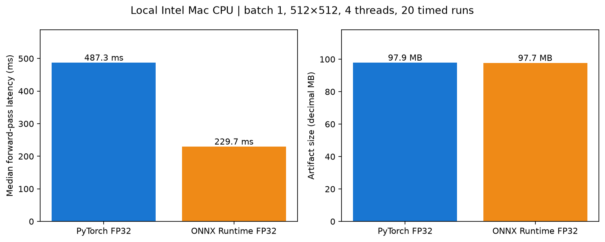

Measured on an Intel i7-8850H Mac: four CPU threads, batch size one, three warm-up runs and 20 alternating timed runs per runtime using the same validation chip. ONNX Runtime has approximately **2.1× lower median latency** in this run. Timings exclude data loading, startup, preprocessing, sigmoid and mask creation; they are not hosted or end-to-end performance measurements. FP32 export does not materially reduce file size. INT8 quantisation is still pending.

[Export and benchmark report](reports/m1-s1-kaggle-365653491/onnx_fp32/README.md) · [Inference settings](reports/m1-s1-kaggle-365653491/onnx_fp32/inference_config.json) · [Review notebook](notebooks/06_export/06-onnx-cpu-benchmark.ipynb)

The exported graph accepts normalised VV/VH and returns raw logits. Apply sigmoid and threshold > 0.55 outside the graph. The ONNX model is retained locally and excluded from Git; its hash, preprocessing constants, and required input shape are recorded in the inference settings.

## Local GeoTIFF inference

The local ONNX command reads a **512×512 Sentinel-1 VV/VH chip in dB** and saves a compressed water mask and sigmoid-score GeoTIFF while preserving its CRS, affine transform, and dimensions. A provenance report records the input, model and configuration hashes. The prediction path uses ONNX Runtime without importing PyTorch.

```bash
python -m floodrisk.deploy.predict \
  --input /path/to/sentinel1_vv_vh_db_512.tif \
  --model reports/m1-s1-kaggle-365653491/onnx_fp32/m1_s1_fp32.onnx \
  --config reports/m1-s1-kaggle-365653491/onnx_fp32/inference_config.json \
  --output /path/to/new_prediction_directory
```

Defaults assume band 1 is VV and band 2 VH; use `--vv-band` and `--vh-band` for a different band order. Inputs require a CRS and correct dB units. This command handles one fixed-size chip; the separate scene tiling command below handles larger rasters.

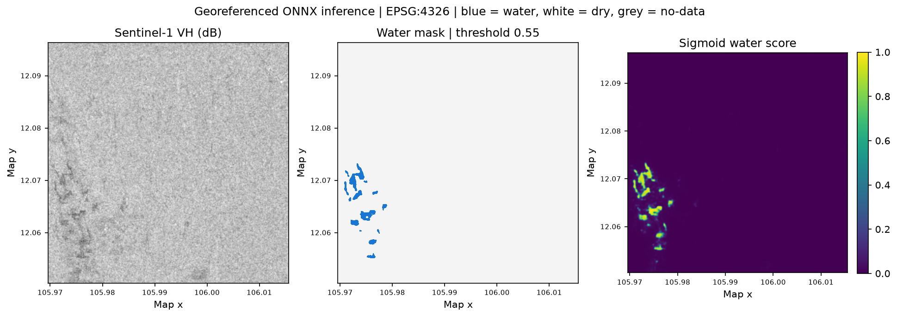

The preview uses the middle-ranked Mekong validation example from the earlier audit. Coordinates are preserved; blue means predicted water. This demonstrates geospatial output alignment, not new accuracy evidence.

The mask encodes dry=0, water=1 and no-data=255. Source-masked or non-finite radar pixels become no-data in both outputs. This explicit deployment policy leaves the original benchmark protocol intact. Scores are not calibrated flood probabilities, and permanent water is still included.

[Usage and verification report](reports/m1-s1-kaggle-365653491/geotiff_demo/README.md) · [Executed notebook](notebooks/07_inference/07-geotiff-inference.ipynb)

## Larger-scene tiling

The scene inference command streams arbitrary raster dimensions through the fixed 512×512 model. The default **64px context margin** retains **384×384 cores**, writes each output pixel once, and crops partial edge tiles to the original image size. CRS, transform, dimensions and no-data masks are preserved. The command uses window-sized arrays instead of loading the whole scene.

```bash
python -m floodrisk.deploy.tiled \
  --input /path/to/sentinel1_vv_vh_db_scene.tif \
  --model reports/m1-s1-kaggle-365653491/onnx_fp32/m1_s1_fp32.onnx \
  --config reports/m1-s1-kaggle-365653491/onnx_fp32/inference_config.json \
  --output /path/to/new_scene_prediction --halo 64
```

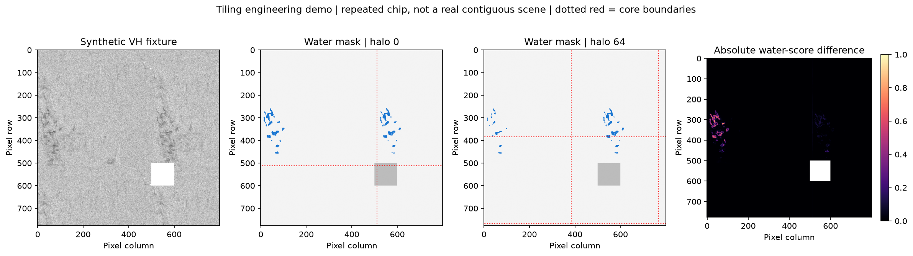

This **engineering fixture repeats a known chip**, crops it to 800×777, and adds a missing-data square; it is not a real contiguous satellite scene. Dotted red lines indicate output core boundaries. Both runs preserve all 611,600 valid pixels and 10,000 no-data pixels. Context changes 1,717 binary predictions, demonstrating sensitivity rather than proven accuracy or seam reduction. A real-scene processing check is documented below; independent accuracy evaluation remains pending.

[Implementation, caveats and test results](reports/m1-s1-kaggle-365653491/tiling_demo/README.md) · [Reproducible notebook](notebooks/08_tiling/08-scene-tiling.ipynb)

## First real Lagos-area scene

Earth Engine acquisition and tiled ONNX inference have completed on a **real contiguous Sentinel-1A acquisition from 12 August 2022**, around 3.45°E, 6.55°N. The 1024×1024 grid uses VV/VH in dB at **10m**, EPSG:32631, with **100% usable radar coverage**. The source identity, orbit, file hash, and exact grid are recorded.

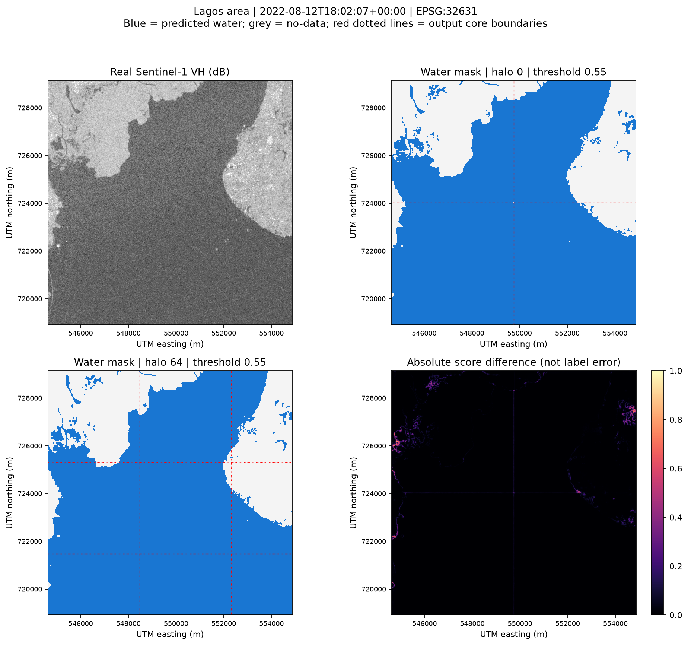

The frozen model at threshold 0.55 predicts 783,833 water pixels with halo 0 and 780,904 with halo 64. The settings disagree on **0.33% of pixels**. Map grids and no-data masks are preserved. Differences occur near shorelines and tile boundaries; this comparison measures context sensitivity, not correctness.

**These are water predictions, not confirmed flood extent.** Permanent lagoon water remains included, and no independent labels are available for an accuracy score. The date follows the saved acquisition rule, rather than a confirmed flood-event label.

[Real-scene report](reports/lagos_2022/README.md) · [Executed notebook](notebooks/09_lagos/09-real-scene-inspection.ipynb) · [Acquisition setup](ee/README.md)

## Historical water context

A JRC 1984–2021 occurrence reference is now aligned to the Lagos radar grid. Using an exploratory **≥90% historical occurrence** rule, **694,273 of 780,904 predicted water pixels** fall within high-frequency historical water. A further 68,565 have lower occurrence and 18,066 have unavailable/masked reference values.

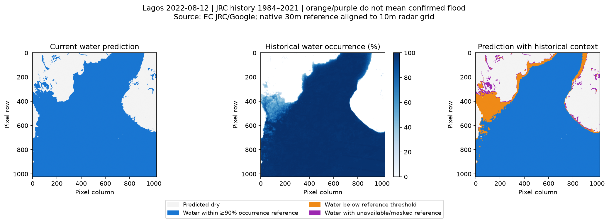

Blue indicates water inside the high-frequency reference; orange water below its threshold; purple unavailable/masked reference. Neither orange nor purple establishes flooding. The native 30m reference is aligned to 10m without gaining detail. It predates this 2022 observation; earlier historical modelling requires a temporally appropriate reference to avoid future-data leakage.

[Interpretation and provenance](reports/lagos_2022/water_reference/README.md) · [Executed notebook](notebooks/10_water_reference/10-historical-water-context.ipynb)

## Rainfall inputs

Historical rainfall and forecast acquisition now work, with validated time windows. CHIRPS provides the **14 complete days before** the 12 August 2022 radar acquisition; the current forecast is archived as an entirely separate snapshot. Features include 1/3/7/14-day historical totals and 24/48/72-hour forecast totals. Missing precipitation is rejected rather than filled with zero.

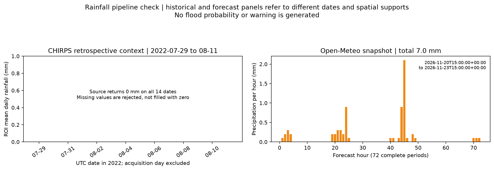

The historical source returns zero for all 14 dates, cross-checked against an independent aggregate. The archived forecast retrieved **20 November 2026** totals **7.0mm** over **20 November 15:00 to 23 November 15:00 UTC**. These panels refer to different dates and spatial supports; the current forecast must never be joined to the 2022 training target. Final retrospective CHIRPS is not evidence of real-time historical data availability. Neither rainfall amount is a flood-risk score.

[Data, timing conventions and caveats](reports/rainfall/lagos_first_snapshot/README.md) · [Executed notebook](notebooks/11_rainfall/11-rainfall-inputs.ipynb)

## Terrain and drainage features

Elevation, slope, hydrologically adjusted elevation and upstream drainage area are now aligned to the Lagos grid. Slope is calculated at **30m** before alignment; MERIT hydrology remains approximately **90m** source information. Alignment to 10m does not add detail.

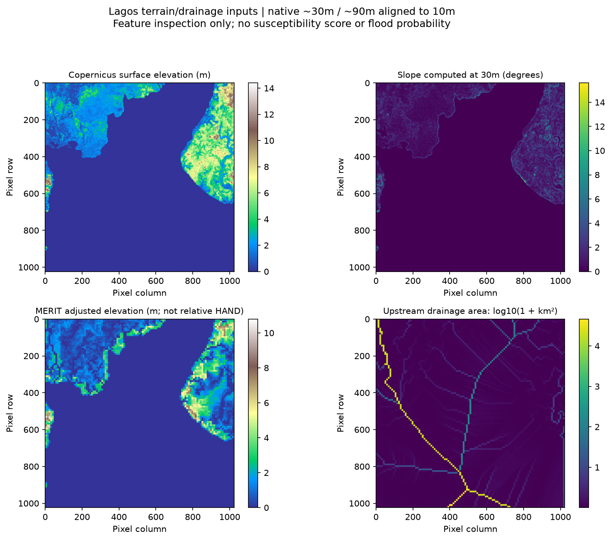

The layers are aggregated into **10,609 nominal 100m feature cells** with means, maxima, valid fractions and explicit partial-edge dimensions. Missing values remain distinct from zero. These records contain no flood labels or susceptibility scores.

MERIT `hnd` is retained as **adjusted elevation**, not assumed to be relative height above nearby drainage. True HAND is still pending. Copernicus is a surface model including buildings/vegetation; the 2024_1 processed edition is not established as available at the 2022 issue time. Coastal hydrology and spatial validation need particular care in this lagoon-heavy area.

[Source semantics, tests and reproduction](reports/lagos_2022/terrain/README.md) · [Feature schema](reports/lagos_2022/terrain/cell_schema.json) · [Executed notebook](notebooks/12_terrain/12-terrain-features.ipynb)

## Land cover and mapped building exposure

WorldCover class shares and mapped building features are now joined to the **10,609 nominal 100m terrain cells**. The combined engineering table has 34 columns, including identifiers, geometry, validity indicators and feature values. It contains no training labels or risk scores.

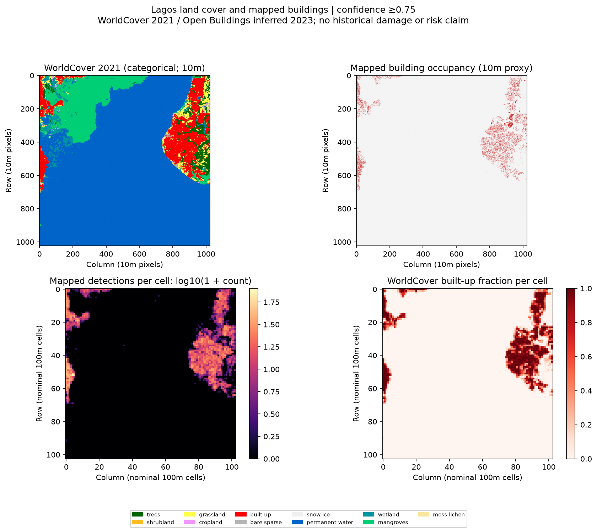

A fixed Open Buildings detection-confidence filter of **≥0.75** retains **17,206 detections** with centroids inside the ROI, distributed across **1,342 cells**. Counts describe mapped detections; the separate 10m footprint raster is an occupancy approximation. These are not household counts, exact footprint-area estimates or flood-damage measurements.

WorldCover describes **2021** land cover; Open Buildings v3 was inferred in **2023**. They are not presented as a verified August 2022 inventory. Zero mapped buildings does not prove no buildings exist, and built-up class share is not measured drainage capacity. Additional independent study areas and reviewed labels are still needed before training.

[Source dates, counts and verification](reports/lagos_2022/surface/README.md) · [Combined schema](reports/lagos_2022/surface/cell_schema.json) · [Executed notebook](notebooks/13_surface/13-landcover-buildings.ipynb)

## Independent-label evidence: Lokoja review case

A matched-orbit radar pair adds a second study area: **13 October 2022** and **18 October 2021**, relative orbit 30, ascending, on identical 10m grids. Lokoja provides a riverine stress-test, not evidence of urban pluvial warning skill. NASA/UNOSAT reports motivate the event-review window; they do not label each chip or cell.

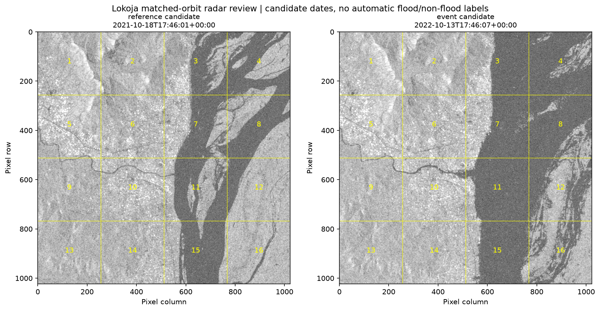

Sixteen 256×256 review chips are queued with **blank labels** and one shared group ID. Raw imagery and independent evidence should be reviewed before model overlays; the prior-year image is not assumed flood-free.

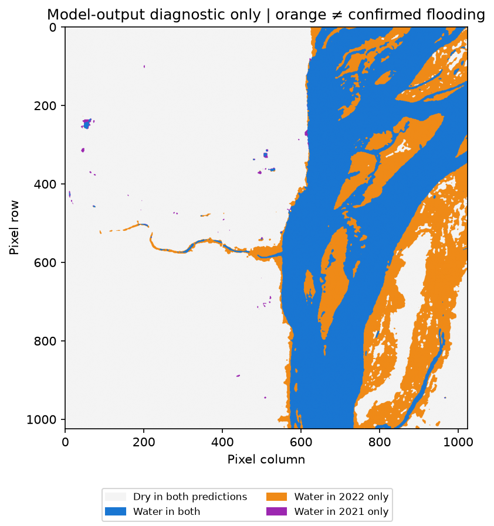

The frozen model predicts 153,364 pixels as water in 2022 only. These are change candidates for investigation, not accepted flood labels or a validated area estimate. **Zero reviewed scene labels** have been accepted. The evidence validator requires reviewer details, an independent evidence reference and observed/review timing; scene-condition labels cannot automatically become pixel masks or 72-hour onset targets.

[Review protocol and caveats](reports/evidence/lokoja_2022_review/README.md) · [Review queue](reports/evidence/lokoja_2022_review/review_queue.csv) · [Executed notebook](notebooks/14_evidence/14-lokoja-review-pair.ipynb)

## October 2022 hotspot observations

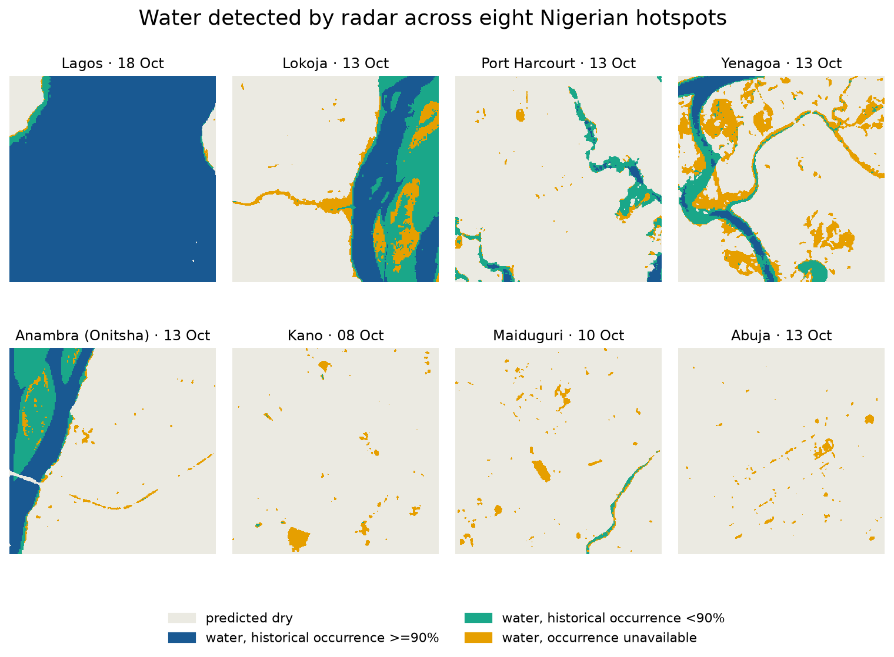

*Each panel spans 5.12 km. Blue marks predicted water where historical water occurrence was at least 90%. Green marks water below that threshold. Amber marks predicted water where the historical layer has no usable value. The date above each panel is the actual satellite pass.*

The February–October pairs contain 40,570 pixels that changed from predicted dry to water in areas of lower historical water occurrence. These are candidates for review. The eight October archives contain 178 tiles, and a second set shows February–October change. A separate overlay counts grid pixels shared by mapped building footprints and predicted water. Their footprints intersect parts of 22 LGAs. The full registry includes all 774 LGAs, so an interface can distinguish an area with imagery from an area outside the sampled windows. [Map package and legend](reports/hotspots_oct22/README.md) · [Reproducible notebook](notebooks/15_hotspots/15-hotspot-observations.ipynb)

## Where does water tend to appear during recorded floods?

A LightGBM model used elevation, slope, adjusted elevation and upstream drainage area to rank locations in 11 recorded Nigerian flood events. The benchmark contains 22,000 samples across training, calibration and testing. The weighting restores the share of mapped water within each event before averaging across events.

| Terrain evaluation | ROC-AUC | What was tested |
|---|---:|---|
| Five spatial folds in the training years | 0.9195 | Transfer to different 50 km blocks |
| Held-out 2018 event, calibrated | 0.9715 | Transfer to a later event in the original flood database |
| Lokoja 2022, prior dry or seasonal water class required | 0.3272 | Agreement with the external VIIRS map on 227 eligible points |
| Lokoja 2022, unknown prior water class included | 0.9394 | Same comparison on a wider population of 3,228 points |

A score of 0.5 corresponds to chance ranking. The model did well across the wider Lokoja landscape but poorly within the restricted water-history sample. The wider check was added after inspecting the restricted result. Both use the same frozen model. Neither evaluation measures the timing of a future flood or verifies street-level warnings. [Model card, baselines and source provenance](reports/nigeria_gfd/README.md)

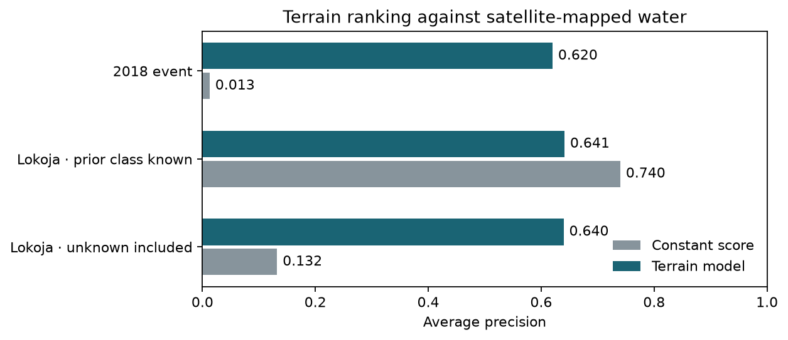

*The gray bars show the mapped-water fraction in each evaluation. A constant score achieves that average precision. The terrain model falls below that baseline in the restricted Lokoja sample, even though it exceeds the baseline in the wider landscape.* [Executed comparison notebook](notebooks/17_terrain_evaluation/17-terrain-evaluation.ipynb)

## National rainfall inputs

The first complete batch archived a rainfall input row for every LGA at a common issue time on **23 November 2026**. Its forecast covers **23 November 10:00 to 26 November 10:00 UTC**. Each row combines model-estimated rainfall over the preceding 14 complete days with forecast totals for the next 24, 48 and 72 hours. These are point estimates in millimetres. The archive contains rainfall inputs only. [Batch summary](reports/rainfall/national_20261123/summary.json) · [774 input rows](reports/rainfall/national_20261123/rainfall.csv)

## How prediction becomes a warning

The current U-Net answers **“which pixels look like water in this radar acquisition?”** It reads preprocessed VV/VH, outputs a water score per pixel, and applies threshold 0.55. It does not use rainfall or predict future events. Its map date is the satellite acquisition date, rather than a monthly or weekly forecast period.

The target system combines three distinct outputs:

| Component | Inputs and output | Intended refresh |
|---|---|---|
| M1 water observations | Radar imagery → water masks; compare against permanent-water references | As suitable new acquisitions become available |
| M2 susceptibility | Terrain, drainage, land cover, buildings, climate and historical flooding → where tends to flood | Periodically when data/models are rebuilt |
| M3 near-term event risk | Susceptibility, recent rainfall and forecast rainfall → experimental LGA risk over the next 72 hours | Daily scoring; 72 hours is the forecast horizon |

Rainfall is therefore essential to the planned forecasting stage. [Open-Meteo](https://open-meteo.com/en/docs) supplies hourly rainfall forecasts; historical rain and event labels will support training. The event-risk target must be explicitly time-aligned: a flood detected between infrequent satellite observations does not by itself prove that it began within a particular 72-hour forecast window. Forecast inputs must have been available at the scoring time; observed future rainfall would leak information into evaluation.

The intended public app lets a user select an LGA, view Low/Elevated/High experimental risk with its issue time and validity window, and opt into notifications when risk rises. This requires calibrated and independently evaluated M3 outputs, measured lead time and false-alarm performance, daily data freshness checks, and alert deduplication. Risk bands and notification thresholds must be chosen from validation evidence. These features are **planned**, not present capabilities. The system is an experimental research product, not an official warning service.

## Approach

| Component | Task | Progress |
|---|---|---|
| **M1 · Water segmentation** | Detect water in Sentinel-1 VV/VH radar imagery using U-Net. Derive flood extent later by excluding permanent water. | Training and held-out evaluation complete. |
| **M2 · Flood susceptibility** | Estimate where flooding tends to occur using terrain, drainage, land cover, buildings, and climate features. | Coarse event-conditional terrain benchmark evaluated. Full national feature model remains open. |
| **M3 · Event risk** | Combine susceptibility with recent and forecast rainfall to estimate 72-hour LGA risk. | Temporal training and daily batch code tested on fixtures. Awaiting reviewed outcomes. |

The planned product focuses on rain-driven and urban flooding: a national map at 30 m resolution, 10 m hotspot detail, LGA search, building exposure statistics, and a CPU model demo. Hotspots include Lagos, Port Harcourt, Lokoja, Yenagoa/Bayelsa, Anambra, Kano, Maiduguri, and Abuja.

The target architecture uses Earth Engine for geospatial preparation, Next.js and MapLibre for the map, PMTiles on Cloudflare R2, Supabase for LGA statistics, a Hugging Face CPU demo, and GitHub Actions for daily scoring. The initial Earth Engine acquisition path is implemented; the other serving integrations remain planned.

## Data and model

M1 uses the hand-labelled **Sen1Floods11** dataset with its train, validation, test, and Bolivia splits. Each chip contains two Sentinel-1 bands with shape `2 × 512 × 512`. Labels are `-1` (ignore), `0` (dry), and `1` (water).

| Training-split statistic | Value |
|---|---:|
| Chips | 252 |
| Pixels with NaN in either input band | 2.01% |
| No-data labels | 13.26% |
| Water share of valid labels | 9.51% |

| Band | Clip range, dB | Mean | Standard deviation |
|---|---|---:|---:|
| VV | [-30, 5] | -10.394 | 4.020 |
| VH | [-42, -5] | -17.232 | 4.691 |

Normalisation statistics are estimated from sampled training pixels after excluding NaN locations and applying clipping. The loader standardises each band and replaces NaNs with zero in normalised space. Both the loss and metrics ignore no-data labels. The implemented VH range follows exploration results; the original specification proposed `[-35, 0]`.

### Training configuration

The current source and training notebook define:

| Setting | Configuration |
|---|---|
| Model | U-Net with ImageNet-pretrained ResNet-34 encoder |
| Input / output | VV + VH / one water logit per pixel |
| Loss | Masked binary cross-entropy + Dice |
| Optimiser | AdamW; learning rate `3e-4`; weight decay `1e-4` |
| Schedule | Cosine annealing; 60 epochs |
| Batch size / seed | 8 / 42 |
| Augmentation | Random 90° rotations and horizontal flips |
| Precision | Mixed precision on CUDA |
| Checkpoint selection | Maximum validation water IoU |
| Decision threshold | Water probability > 0.5 |

The downloaded run does not include a source commit or environment manifest, so these settings describe the current implementation rather than independently verified run metadata.

## Getting started

Use Python 3.10 or newer. From the repository root:

```bash
python3 -m venv .venv
source .venv/bin/activate
python -m pip install --upgrade pip
python -m pip install torch torchvision
python -m pip install -e .
python -m pip install jupyterlab matplotlib
```

For Intel Macs using Python 3.12, install with the tested compatibility constraints (PyTorch 2.2.2 requires NumPy 1.x in this environment):

```bash
python -m pip install -c requirements/macos-intel.txt torch torchvision -e .
python -m pip check
```

The Intel Mac constraints pin the core evaluation packages; they are not a complete cross-platform lockfile. Raw imagery and model checkpoints are not included in Git.

### Dataset layout

Provide a local dataset directory with files matching the official split CSVs:

```text
sen1floods11/
├── S1Hand/
├── LabelHand/
├── S1OtsuLabelHand/       # needed for Otsu baseline evaluation
└── splits/
    ├── flood_train_data.csv
    ├── flood_valid_data.csv
    ├── flood_test_data.csv
    └── flood_bolivia_data.csv
```

### Evaluate the trained checkpoint

The local evaluation command runs on CPU, loads the checkpoint without downloading encoder weights, and writes pooled test and Bolivia metrics with the checkpoint hash:

```bash
python -m floodrisk.eval.run \
  --root /path/to/sen1floods11 \
  --checkpoint best.pt \
  --output reports/m1-s1-kaggle-365653491/evaluation.json
```

The default batch size is 1 to limit memory use. An existing output report is never overwritten. Evaluation has been completed locally. Choose a new output filename when rerunning to preserve the recorded report.

## Development workflow

**Develop and maintain notebooks locally; use Kaggle only for training.** Local work includes exploration, evaluation, and reporting. The environment for future national batch inference remains to be selected.

1. Version source and notebooks locally. Make the intended code revision available to the Kaggle training session.
2. Train on Kaggle with Sen1Floods11 attached and GPU enabled.
3. Download `best.pt`, `history.csv`, and the executed notebook after each run.
4. Archive small run records in `reports/<run-id>/`; retain weights locally or in a model artifact store.
5. Evaluate the selected checkpoint on held-out splits and update the results table from the saved report.

The exploration and diagnostics notebooks run locally. They use dataset version 1 in the KaggleHub cache by default; set `SEN1FLOODS11_ROOT` to use another location. Select the project `.venv` as the notebook kernel in your editor. Install notebook dependencies with `python -m pip install -c requirements/macos-intel.txt matplotlib ipykernel nbclient` on Intel macOS.

The training notebook intentionally retains Kaggle execution paths and installs the GitHub version, so unpublished local edits are not used by that installation.

Automatic experiment tracking, remote checkpoint backup, and training resume are future improvements.

## Repository structure

```text
floodrisk/
├── datasets/sen1floods11.py  # loading, normalisation, augmentation
├── acquire/                # real-scene Earth Engine downloader
├── models/                 # U-Net and masked BCE + Dice
├── train.py                # training and validation
├── deploy/                 # ONNX export, verification, CPU benchmark
├── eval/                   # pooled IoU and checkpoint evaluation CLI
├── features/               # planned geospatial feature pipeline
├── tiling/                 # planned inference tiling
└── scoring/                # planned event-risk scoring
notebooks/
├── 01_explore/             # saved exploration and baseline outputs
├── 02_train_m1/            # training notebook
├── 03_evaluate/            # local prediction diagnostics
├── 04_validation/          # input-quality and validation error audit
├── 05_threshold/           # validation-only threshold experiment
├── 06_export/              # ONNX verification and CPU benchmark review
├── 07_inference/           # georeferenced prediction example
├── 08_tiling/              # streamed scene tiling engineering checks
├── 09_lagos/               # first real Lagos scene inspection
├── 10_water_reference/     # historical water context and limitations
├── 11_rainfall/            # historical rainfall and forecast input checks
├── 12_terrain/             # terrain/drainage layers and 100m feature cells
├── 13_surface/             # land-cover and mapped-building features
├── 14_evidence/            # orbit-matched pair and independent-label review queue
├── 15_hotspots/            # historical radar observation maps
├── 16_optical/             # local source for Kaggle optical comparison
├── 17_terrain_evaluation/  # interpretation of the terrain benchmark
└── 18_sensor_comparison/    # optical history and matched-pixel evaluation
reports/                   # training history, artifact summaries, evaluation reports
data/                      # small reference data placeholder
ee/                        # Earth Engine setup guide and Lagos download plan
jobs/                      # offline daily research scoring entry point
space/                     # model demo placeholder
web/                       # frontend placeholder
```

## Roadmap

- [x] Explore Sen1Floods11 and establish preprocessing statistics.
- [x] Evaluate provided Otsu masks on test and Bolivia splits.
- [x] Implement M1-S1 and complete a 60-epoch training run.
- [x] Archive training history and checkpoint fingerprint.
- [x] Evaluate the trained checkpoint on test and Bolivia splits.
- [x] Adapt exploration notebooks for local execution.
- [ ] Build a reserved Nigerian test set; report uncertainty.
- [x] Export FP32 ONNX, verify validation predictions, and benchmark local CPU latency.
- [x] Implement single-chip georeferenced ONNX inference with explicit no-data outputs.
- [x] Implement streamed scene tiling and verify pixel placement on engineering fixtures.
- [x] Compare context margins on one real Lagos-area scene and verify geospatial output.
- [ ] Establish independent real-scene accuracy and boundary-quality evaluation before operational mapping.
- [x] Evaluate INT8 quantisation on the local Intel CPU.
- [ ] Benchmark on the eventual deployment host.
- [x] Package eight dated hotspot observations with historical water context as PMTiles.
- [ ] Expand observation coverage and build the first map interface.
- [x] Evaluate the coarse terrain prototype with spatial blocks, a 2018 holdout and an external Lokoja comparison.
- [ ] Validate the full national M2 target and produce multi-season LGA aggregates.
- [x] Acquire historical rainfall and timestamped forecast inputs; validate their time windows.
- [ ] Train, calibrate, and evaluate M3 using forecast rainfall; implement daily scoring.

## Limitations and intended use

Water segmentation has global benchmarks and a four-chip Nigerian subset. Independent Nigerian field accuracy, nationwide exposure and 72-hour warning skill remain unverified. Radar shadows, urban structures, geographic domain shift, and satellite revisit gaps can limit flood detection, especially for short-lived street flooding.

Future event-risk evaluation must account for sparse satellite-derived labels and the difference between observed and forecast rainfall.

**This is an experimental research project, not an official flood-warning service.** Consult NIHSA and NEMA for official guidance.

## References

- [Sen1Floods11 dataset and code](https://github.com/cloudtostreet/Sen1Floods11)
- [Bonafilia et al., Sen1Floods11 — CVPR Workshops 2020](https://openaccess.thecvf.com/content_CVPRW_2020/html/w11/Bonafilia_Sen1Floods11_A_Georeferenced_Dataset_to_Train_and_Test_Deep_Learning_CVPRW_2020_paper.html)
- [Segmentation Models PyTorch](https://github.com/qubvel-org/segmentation_models.pytorch)

The original local build specification, `Nigeria_Flood_Risk_Mapper_Spec.pdf`, describes the broader product and planned data sources. Source attribution and usage terms should be reviewed as those integrations are implemented.

## Verification

Run `python -m unittest discover -s tests -v` in the project environment. The current local suite has 26 passing tests. Real-model integration tests require the local ONNX export and skip explicitly when it is absent. GitHub Actions runs offline checks and notebook/Python validation without credentials, imagery or model binaries; passing CI does not replace local model or live-acquisition checks.
