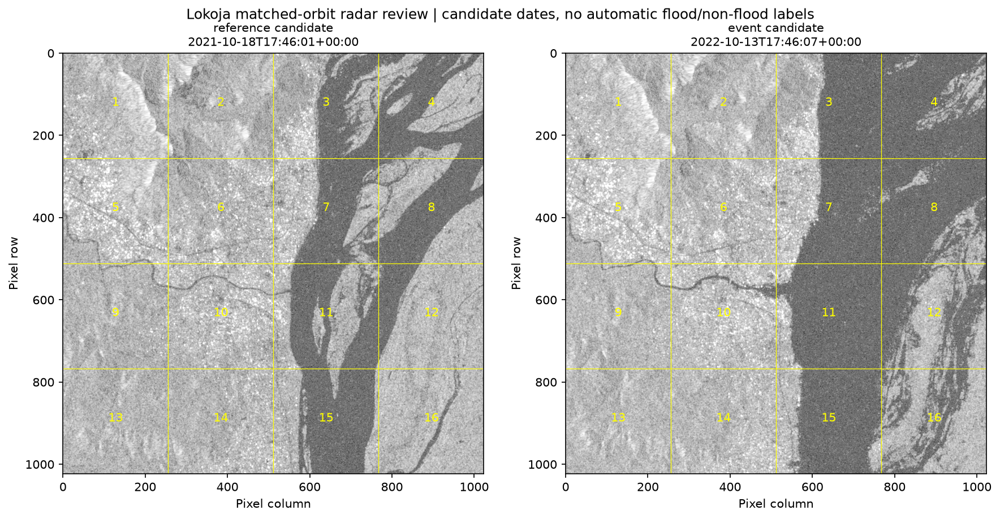
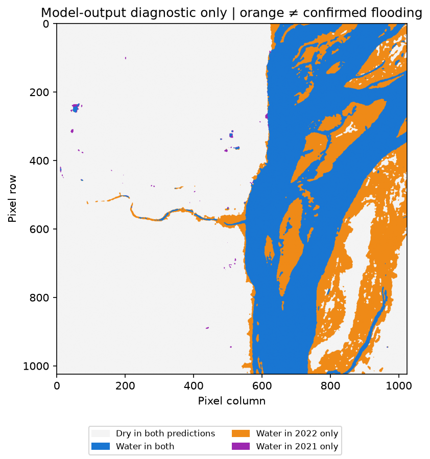

# Lokoja candidate evidence pair and label-review queue

This case adds a second geographic study area and a riverine-confluence stress-test to the Lagos engineering work. It does not establish urban pluvial flood-warning performance. The review queue has **16 unlabelled 256×256 chips**, all assigned the same case/group ID; **zero reviewed scene labels** are currently accepted.

## Context and acquisition

[NASA's 13 October 2022 report](https://science.nasa.gov/earth/earth-observatory/flooding-inundates-southern-nigeria-150463/) describes flooding around Lokoja. [UNOSAT product 3418](https://unosat.org/products/3418) reports satellite-detected water over Nigeria during 13–17 October. These are event-context sources; their reporting/mapping scale does not supply independent 10m pixel truth or prove every 100m cell flooded.

The fixed acquisition rule selects the full-footprint scene closest to 15 October within October 2022. The prior-year October reference must use the selected event's relative orbit and pass. The 10.24km engineering ROI is centred at 6.74°E, 7.79°N, EPSG:32632; it is not an LGA boundary.

| Candidate | Acquisition UTC | Relative orbit | Pass |
|---|---|---:|---|
| 2022 event-window candidate | 2022-10-13 17:46:07 | 30 | Ascending |
| 2021 reference candidate | 2021-10-18 17:46:01 | 30 | Ascending |

Both grids are 1024×1024 at 10m. Source hashes, exact scene identifiers, coverage checks, selection dates and case grouping are in [pair.json](pair.json). Matching orbit/grid reduces an acquisition confounder; seasonal, hydrological and other differences remain. The prior-year reference is **not assumed flood-free**.

## Review imagery



Yellow lines divide the raw VH imagery into review chips; both use the same fixed dB display range. These images are review candidates. They do not create labels or identify which pixels are flooded.

## Model diagnostic, separate from independent review



The unchanged ONNX checkpoint and threshold 0.55 were run with halo 64. The comparison contains 243,852 pixels predicted as water on both dates, **153,364 predicted as water in 2022 only**, 951 as water in 2021 only, and 650,409 as dry in both. All 1,048,576 pixels are accounted for; no radar no-data pixels occur. [Summary](summary.json) and per-date prediction manifests preserve these results.

Orange denotes a change candidate, not confirmed flooding. Model errors, seasonal variations and other surface changes are possible. No new IoU, validated flood-area total, susceptibility score or event probability is claimed.

## Review protocol

1. Review raw paired VV/VH imagery and independent dated evidence first, without model overlays. Record uncertainty rather than guessing.
2. Keep every chip initially `pending`, with an empty label. A date inside a reported flood window is not itself a positive label; a prior-year date is not automatically negative.
3. A reviewed flood/non-flood scene-condition label requires a named reviewer, evidence type and URI, observed start/end times, and review timestamp. Model outputs alone cannot satisfy the evidence gate. The validator checks completeness, not the truth of external evidence.
4. Preserve `uncertain`/unreviewed cases outside the accepted set. Chip-level scene labels are not segmentation masks; do not automatically propagate one label to every enclosed 100m cell.
5. Keep all chips and dates from this case in one split group. Add multiple independent regions/events before defining train/validation/test partitions. Current model-derived diagnostics have already been inspected, so do not present these as a pristine untouched benchmark.
6. A 72-hour event-risk target requires independent timing evidence. This pair cannot establish flood onset within a particular 72-hour interval.

[Review queue](review_queue.csv) · [Executed notebook](../../../notebooks/14_evidence/14-lokoja-review-pair.ipynb) · [Case definition](../../../data/cases/lokoja_2022.json)

The queue has no training-ready targets. Human-reviewed annotation and supporting evidence are the next required input. This prepares the work without fabricating ground truth.

## Reproduce

```bash
python -m floodrisk.acquire.evidence \
  --project manifest-ivy-453612-b3 \
  --case data/cases/lokoja_2022.json \
  --output data/scenes/lokoja_2022_review
```

Completed acquisitions can be reused only when their saved settings match; reference orbit/pass and pair grids are verified. Run the notebook to produce predictions and figures; existing review CSV contents are preserved. Nineteen local tests pass, including review-queue coverage, grouping, absence of automatic labels, and rejection of model-only evidence or invalid time fields.
