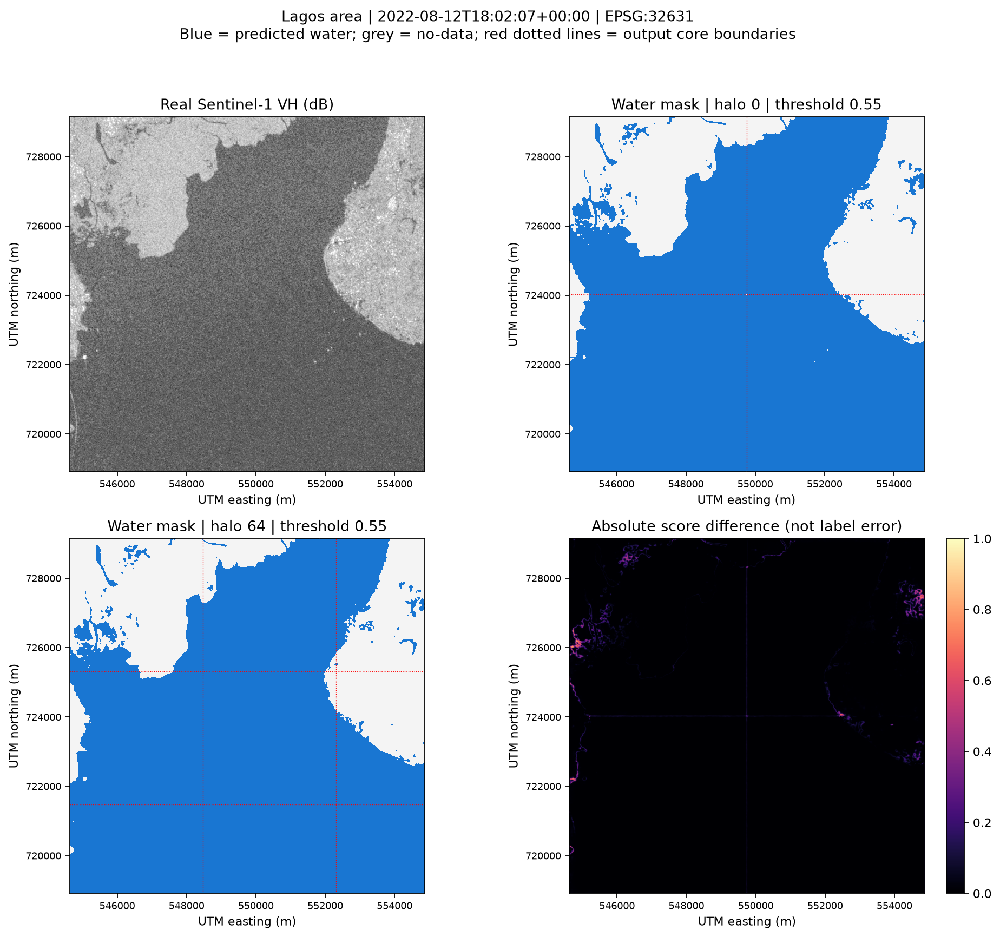

# First real Lagos-area scene inspection

The Earth Engine acquisition and tiled ONNX inference completed on a **real contiguous Sentinel-1 scene**, replacing the earlier repeated-chip fixture for this processing check. This is an unlabelled engineering inspection, not a Nigerian accuracy benchmark or confirmed flood detection.

## Acquired input

| Property | Value |
|---|---|
| Acquisition | 2022-08-12 18:02:07 UTC |
| Platform / orbit | Sentinel-1A / ascending, relative orbit 1 |
| Source | Earth Engine `COPERNICUS/S1_GRD` |
| Scene index | `S1A_IW_GRDH_1SDV_20220812T180207_20220812T180232_044523_055032_0565` |
| Grid | 1024×1024 at 10m; EPSG:32631 |
| Study area | 10.24×10.24 km around 3.45°E, 6.55°N; an engineering ROI, not an LGA boundary |
| Bands | VV then VH, float32 dB |
| Usable coverage | 1,048,576 pixels / 100% |

The saved rule selected the earliest full-footprint IW dual-pol 10m acquisition among the first 50 chronological candidates in August–October 2022. This date was not selected from a flood-event report. [Acquisition provenance](acquisition.json) records the exact grid, orbit and source hash. The downloader verified band count, grid identity, and data coverage; values were already dB and were not log-transformed again. [Dataset documentation](https://developers.google.com/earth-engine/datasets/catalog/COPERNICUS_S1_GRD) describes the source processing.

## Frozen-model comparison

The same ONNX checkpoint, preprocessing, and threshold **0.55** were used for both context settings. Source and output CRS, transform, shape, and no-data masks were checked.

| Context margin | Retained core | Predicted water pixels |
|---|---:|---:|
| Halo 0 | 512×512 | 783,833 |
| Halo 64 | 384×384 | 780,904 |

The two outputs differ on **3,485 pixels (0.3324%)**. Mean absolute sigmoid-score difference is **0.004724**. These values quantify context sensitivity, not accuracy or evidence that one setting is better. Summary values and band statistics are in [inspection.json](inspection.json); provenance for each prediction is in [halo 0](halo_0_prediction.json) and [halo 64](halo_64_prediction.json).

The masks broadly follow the large dark radar-water boundary, with differences visible near shorelines and some tile boundaries. This is a qualitative observation only. Blue represents predicted water; dotted red lines show output core boundaries; the difference panel shows disagreement between model outputs, not error against human labels.

## Interpretation limits

- No independent labels were provided, so no IoU, precision, recall, or Nigerian accuracy claim is made.
- A large share of the scene is predicted as water. Permanent lagoon/river water remains included; these masks must not be described as flood extent.
- Source processing and geography may differ from Sen1Floods11 despite matching band order and units.
- A 64px margin does not guarantee seam-free predictions; boundary/context effects remain visible in the difference image.
- This one date and small area do not validate national scale, event forecasting, or urban flash-flood detection.

Next: align a permanent-water reference with this grid, distinguish predicted water from water outside that reference, and retain uncertainty about event-specific flooding. Independent labels are still required for accuracy evaluation.

## Reproduce

Follow [Earth Engine setup](../../ee/README.md), then run the [executed notebook](../../notebooks/09_lagos/09-real-scene-inspection.ipynb). It verifies the scene hash, runs both context settings when outputs are absent, checks grid preservation, saves the report, and exports the figure displayed above.

Raw input is at `data/scenes/lagos_2022/sentinel1_vv_vh_db.tif`; prediction rasters are at `data/predictions/lagos_2022/halo_0/` and `halo_64/`. They are retained locally and excluded from Git. The small manifests, figure and notebook outputs remain reviewable in the repository.
