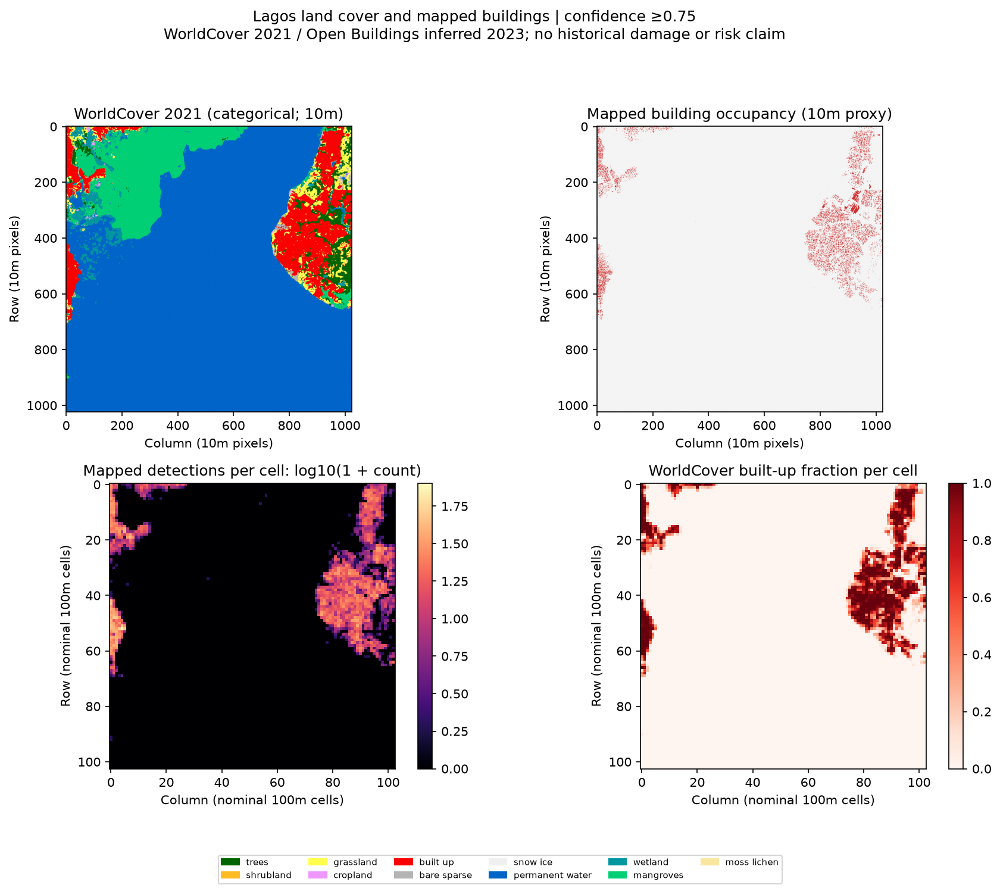

# Land cover and mapped building exposure

WorldCover and mapped building features have been joined to the existing **10,609 nominal 100m terrain cells**. The combined table has 34 columns, including cell identifiers, geometry, validity indicators and feature values. It has no flood labels, damage labels or risk scores.

## Sources and selection

- [ESA WorldCover v200](https://developers.google.com/earth-engine/datasets/catalog/ESA_WorldCover_v200): 2021 categorical land cover at 10m, 11 classes. Nearest-neighbour alignment preserves categories. Built-up share is a land-cover feature, not a measured impervious-surface fraction or drainage capacity.
- [Google Open Buildings v3](https://developers.google.com/earth-engine/datasets/catalog/GOOGLE_Research_open-buildings_v3_polygons): mapped polygon detections, inferred May 2023. A **confidence ≥0.75** filter was fixed before inspecting results. Detection confidence concerns buildings; it is not a flood probability or a locally calibrated accuracy guarantee.

WorldCover describes 2021, while the building product was inferred after our August 2022 radar scene. Neither product's availability at a historical issue time is established. This is present-day feature engineering, not an as-of-2022 exposure assessment. Source omissions, false detections and temporal changes remain relevant.

## Results

| Quantity | Value |
|---|---:|
| Selected detections with centroid inside ROI | 17,206 |
| 100m cells containing selected centroids | 1,342 |
| WorldCover built-up pixels | 86,743 |
| WorldCover permanent-water pixels | 754,814 |
| Rasterized building-occupied 10m pixels | 24,998 |
| WorldCover no-data pixels | 0 |
| Combined feature cells | 10,609 |



The land-cover panel is categorical. The footprint panel is a 10m rasterization proxy, not exact polygon footprint area. Building-count shading uses log10(1 + count) for display; the table retains integer counts. The built-up-fraction panel uses proportions from 0 to 1. White/empty building areas mean no retained mapped detection, not verified absence of buildings. None of these panels indicates confirmed flooding or damage.

## Cell aggregation

Each selected building detection is assigned to one cell by its centroid. Centroids outside the ROI are excluded from counts; the occupancy raster can include footprint portions intersecting the ROI from polygons with external centroids. These boundary conventions are intentionally distinct.

WorldCover class fractions use available categorical pixels as the denominator, with a separate valid-pixel fraction. Empty/missing category shares remain blank rather than zero. Occupancy gets its own valid fraction and rasterized fraction. Partial edge cells retain their actual dimensions. Class shares sum to one wherever land-cover data exist, and the cell counts conserve all 17,206 selected detections.

[Feature schema](cell_schema.json) · [First ten rows](cell_sample.csv) · [Acquisition provenance and category counts](surface.json) · [Centroid counts by cell](building_centroid_counts.json) · [Executed notebook](../../../notebooks/13_surface/13-landcover-buildings.ipynb)

Local source layers and full combined table are retained at `data/surface/lagos_first/` and excluded from Git. The report preserves small manifests, summaries and the saved figure.

## Reproduce

```bash
python -m floodrisk.acquire.surface \
  --project manifest-ivy-453612-b3 \
  --acquisition data/scenes/lagos_2022/acquisition.json \
  --output data/surface/lagos_new_run
python -m floodrisk.features.surface \
  --terrain data/terrain/lagos_first/terrain_cells_100m.csv \
  --surface data/surface/lagos_new_run/surface_features.tif \
  --counts data/surface/lagos_new_run/building_centroid_counts.json \
  --output data/surface/lagos_new_run/combined_cells_100m.csv
```

Seventeen project tests pass. New tests cover class-share normalisation, missing data, partial edge cells, count conservation and rejection of misaligned cell centres. The notebook verifies the source hash, exact terrain/surface CRS and grid alignment, pixel coverage, class fractions, categorical plot coverage and conserved building counts.

## Modelling implications

The study area is dominated by lagoon water, with mapped development around the edges. More independent areas, dates and reviewed event/non-event labels are required before fitting a susceptibility model. Adjacent cells are not independent observations. Building density is an exposure/development descriptor, not proof that buildings cause flooding. Spatial/event validation and temporal source controls remain necessary.

## Attribution

WorldCover: Zanaga et al. (2022), *ESA WorldCover 10m 2021 v200*, [doi:10.5281/zenodo.7254221](https://doi.org/10.5281/zenodo.7254221), ESA WorldCover Consortium, CC-BY-4.0. Open Buildings: Google Research; Sirko et al. (2021), *Continental-scale building detection from high resolution satellite imagery*, [arXiv:2107.12283](https://arxiv.org/abs/2107.12283), CC-BY-4.0 as listed for this Earth Engine collection.
