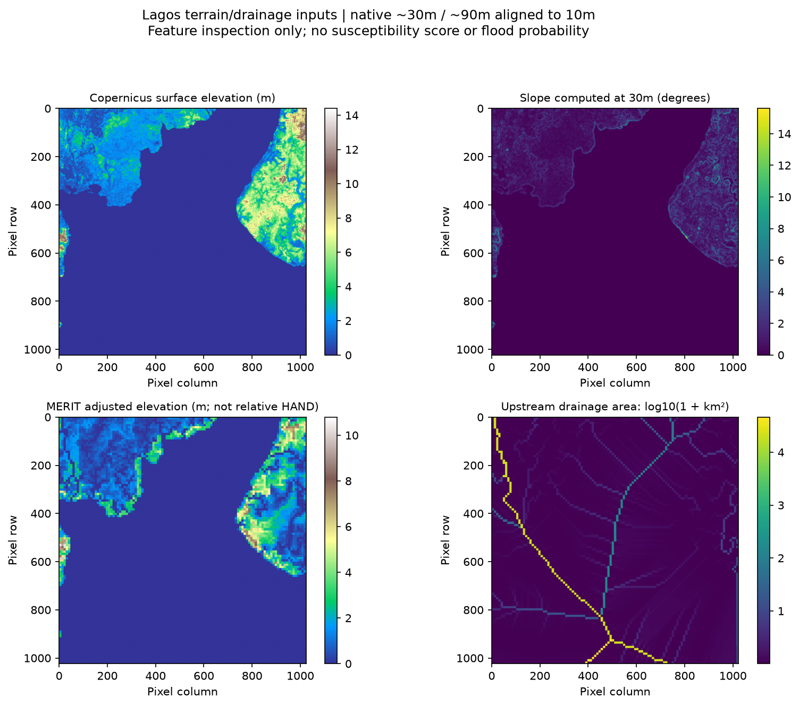

# Terrain and drainage inputs

Four named raster bands are downloaded and aligned exactly to the Lagos radar grid. A local feature builder aggregates them into **10,609 nominal 100m cells**, including partial edge cells. This is a feature-engineering deliverable; no susceptibility model, labels, scores or risk bands are produced.

| Feature | Source | Units | Native/processing detail |
|---|---|---|---|
| Surface elevation | Copernicus GLO-30 2024_1 `DEM` | m | Nominal 30m surface model, including buildings/vegetation |
| Slope | Derived from projected Copernicus DEM | degrees | Computed at 30m before alignment |
| Hydrologically adjusted elevation | MERIT Hydro `hnd` | m | Approximately 90m; not assumed to be relative height above drainage |
| Upstream drainage area | MERIT Hydro `upa` | km² | Approximately 90m; not river discharge or rainfall |

All four bands have 1,048,576 valid aligned pixels and no missing pixels in this ROI. Surface elevation ranges 0–14.41m, slope 0–15.61°, adjusted elevation 0–10.80m, and upstream area approximately 0.00849–46,343km². Large water areas have zero surface elevation/slope in these products; this does not imply zero risk or that dry land is equally flat.



The upstream-area panel uses log10(1 + km²) for display only. Table values retain original units. Alignment to 10m repeats/co-registers source information; it does not increase the native terrain or hydrology detail. The drainage network is not a street-drain inventory and may have coastal/delta limitations.

## Source semantics and time

The [current Copernicus collection](https://developers.google.com/earth-engine/datasets/catalog/COPERNICUS_DEM_GLO30_2024_1) supersedes the legacy collection named in the original spec. Its 2024_1 processed edition is used here for present feature engineering; availability as of the 2022 scene is not established, despite earlier source acquisition periods. The DSM uses EGM2008 vertical datum and includes surface objects.

[MERIT Hydro's catalog](https://developers.google.com/earth-engine/datasets/catalog/MERIT_Hydro_v1_0_1) describes `hnd` as hydrologically adjusted elevations and references EGM96. We preserve it as adjusted elevation rather than silently treating it as relative HAND. True height-above-channel remains a separate derivation requiring an explicit drainage network and consistent datum. Do not subtract the two elevation sources to construct it. The catalog also documents coastal and bifurcation limitations relevant to Lagos.

## Feature cells

The table records projected cell centres, actual edge widths/heights, pixel count, and per-band mean, maximum and valid fraction. Missing means/maxima remain empty, not zero. Interior cells are 100×100m; the last row/column is 40m wide/high. All cells together cover exactly the source pixels.

[Schema and cell count](cell_schema.json) · [First ten rows](cell_sample.csv) · [Source hashes, statistics and processing](terrain.json) · [Executed notebook](../../../notebooks/12_terrain/12-terrain-features.ipynb)

The full local table is `data/terrain/lagos_first/terrain_cells_100m.csv`. It has no flood labels. Spatially adjacent cells share context and source measurements, so random cell splitting would give an unreliable estimate of geographic generalisation. The lagoon-heavy ROI is insufficient by itself for a susceptibility training dataset. Additional locations, event/non-event evidence and temporal controls are needed.

## Reproduce

```bash
python -m floodrisk.acquire.terrain \
  --project manifest-ivy-453612-b3 \
  --acquisition data/scenes/lagos_2022/acquisition.json \
  --output data/terrain/lagos_new_run
python -m floodrisk.features.terrain \
  --raster data/terrain/lagos_new_run/terrain_features.tif \
  --output data/terrain/lagos_new_run/terrain_cells_100m.csv
```

Existing outputs are preserved. The notebook checks source hash, band names, exact alignment, summary statistics, cell count and full pixel coverage. Fifteen project tests pass, including physical ranges, retained negative elevations, valid zeros, missing-data handling, cell centres and partial-edge coverage.

## Attribution and usage

Copernicus DEM: © DLR e.V. and Airbus Defence and Space GmbH, provided under COPERNICUS by the European Union and ESA; see the source catalogue for the licence and attribution wording. MERIT Hydro: Yamazaki et al. (2019), *Water Resources Research*, [doi:10.1029/2019WR024873](https://doi.org/10.1029/2019WR024873); CC-BY-NC 4.0 selected for this noncommercial research use. MERIT's source redistribution restrictions apply. Raw local rasters are excluded from Git; the report publishes derived statistics and a figure.
