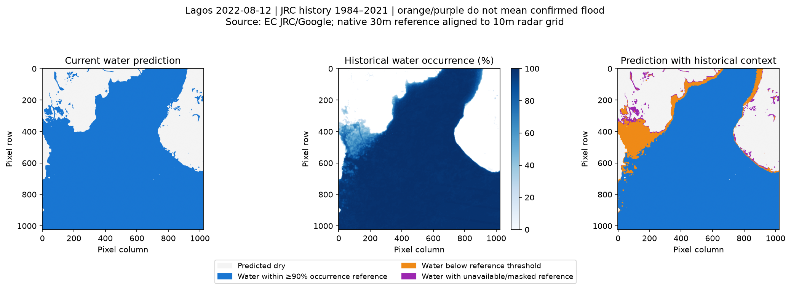

# Historical water context for Lagos

[JRC Global Surface Water v1.4](https://developers.google.com/earth-engine/datasets/catalog/JRC_GSW1_4_GlobalSurfaceWater) records water occurrence over 1984–2021, before the August 2022 radar scene. We downloaded its occurrence band and aligned it exactly to the radar grid using nearest-neighbour resampling. Its native resolution is **30m**; alignment to 10m adds no source detail. Source: EC JRC/Google. Cite Pekel et al., *High-resolution mapping of global surface water and its long-term changes*, Nature 540, 418–422 (2016), [doi:10.1038/nature20584](https://doi.org/10.1038/nature20584).

The exploratory rule **occurrence ≥90%** identifies high-frequency historical water. It is a working exclusion reference, not a validated definition of permanent water. No tuning against this unlabelled scene was performed.

| Category | Pixels |
|---|---:|
| Predicted dry | 267,672 |
| Predicted water within ≥90% occurrence reference | 694,273 |
| Predicted water below that threshold | 68,565 |
| Predicted water with unavailable/masked occurrence | 18,066 |
| Radar no-data | 0 |

Blue indicates predicted water within the high-frequency reference; orange water below its threshold; purple water without an available occurrence value. Orange and purple are **not confirmed flood extent**. JRC masks include locations where water was never detected; unavailable values do not establish adequate historical dry observations. Seasonal water, land-use changes, shoreline alignment and model errors are alternative explanations.

The notebook verifies exact grid alignment and accounts for every pixel. Categories 1–3 sum to the 780,904 predicted water pixels. [Reference provenance](reference.json) records the source, threshold, hashes, resampling and counts. The [executed notebook](../../../notebooks/10_water_reference/10-historical-water-context.ipynb) reproduces the plot. Local rasters are retained at `data/references/lagos_jrc/` and excluded from Git.

This step improves interpretation of satellite observations. Rainfall-driven risk forecasting remains a separate model stage requiring time-aligned event labels, recent rainfall and forecast rainfall. For historical modelling before 2022, this fixed 1984–2021 reference would include future information; use a temporally appropriate reference rather than reusing it indiscriminately.
