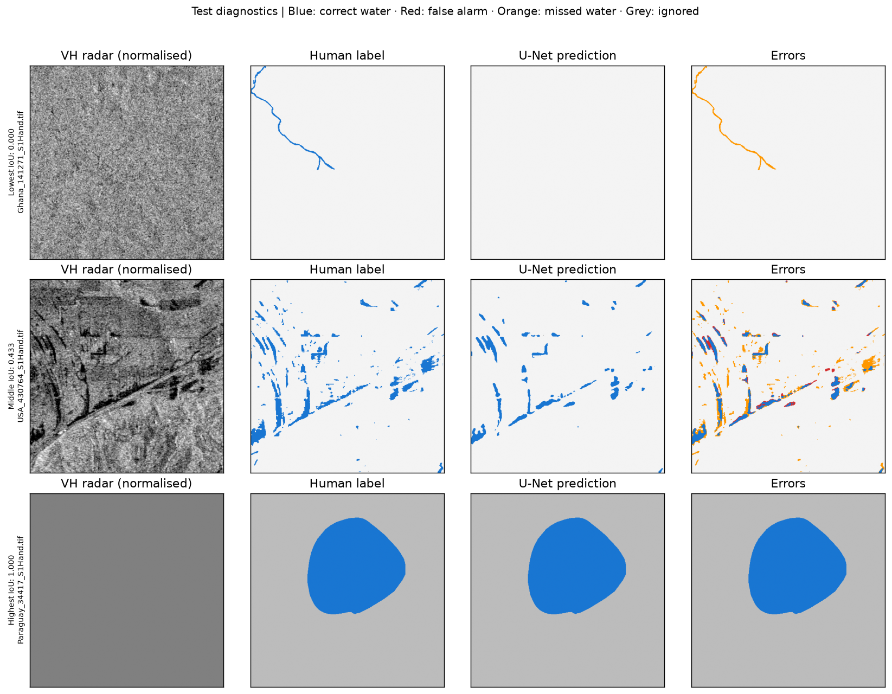
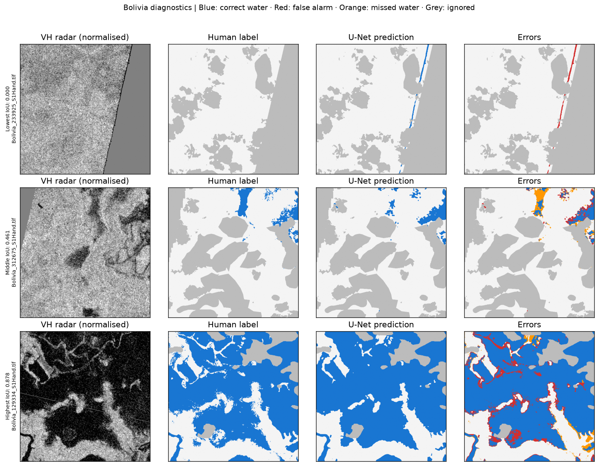

# M1 prediction diagnostics

The [local notebook](../../../notebooks/03_evaluate/03-prediction-diagnostics.ipynb) evaluated all 90 test and 15 Bolivia chips and reproduced both published pooled IoU scores within 1e-6. The checkpoint and threshold were unchanged. [Per-chip counts](per_chip.csv) retain true positives, false positives, false negatives, valid label counts, and water IoU.

| Split | Water precision | Water recall | False-positive pixels | Missed-water pixels |
|---|---:|---:|---:|---:|
| Test | 0.8169 | 0.8265 | 475,413 | 445,218 |
| Bolivia | 0.7563 | 0.8886 | 130,257 | 50,666 |

Precision asks how often predicted water is correct. Recall asks how much labelled water is recovered. Bolivia has relatively high recall but lower precision: false alarms are a useful diagnostic target. These statistics alone do not establish the physical causes of the errors.

## Visual examples

Each figure selects the lowest, middle-ranked, and highest per-chip water IoU among chips containing labelled water, with filename tie-breaking. This is an explicit diagnostic selection, not a representative random sample. Grey is ignored label area; blue is correctly detected water; red is false-positive water; orange is missed water.

## What the examples reveal

- `Ghana_141271`: the model misses the narrow labelled water feature entirely (1,636 labelled water pixels).
- `USA_430764`: the middle-ranked test example misses portions of the labelled water and smooths fragmented boundaries.
- `Paraguay_34417`: the apparently perfect test prediction is misleading as a qualitative success. All input values are NaN; all 50,026 valid label pixels are water. NaNs become zero after preprocessing and the remaining labels are ignored. The metric is correct under the current protocol, but does not demonstrate interpretation of usable radar imagery.
- `Bolivia_233925`: the lowest-ranked Bolivia example has only one labelled water pixel; its zero IoU is sensitive to extremely sparse positive labels. False-positive predictions appear along the edge of the missing-input area.
- `Bolivia_129334`: broad water areas are captured well, but boundary errors remain.

A raw-input audit of all 105 evaluated chips found one entirely NaN input chip, `Paraguay_34417`. [Input quality records](input_quality.json) store the fraction of pixels with at least one NaN band, plus an all-input-NaN flag. The audit used `np.isnan(src.read()).any(axis=0).mean()` and `np.isnan(src.read()).all()` on each original raster.

## Interpretation and next steps

The published benchmark excludes label -1 but does not additionally exclude missing radar inputs. Keep the reported scores and protocol explicit. Before adopting another missing-input policy, compare its effect consistently on both U-Net and Otsu and report it as a separate sensitivity analysis.

Use training/validation data to choose model changes; repeated tuning against these held-out examples would bias the evaluation. Inspect validation-set false positives and input-quality patterns next. Shadow, terrain, and urban explanations remain hypotheses until supported by additional data. Nigeria-specific validation is still required.
