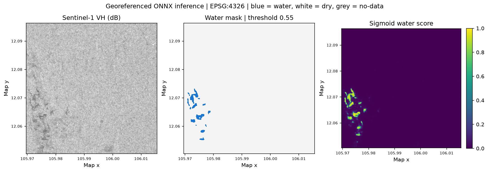

# Local georeferenced inference

The ONNX inference command reads a georeferenced Sentinel-1 dB chip and produces compressed GeoTIFFs with the exact source CRS, affine transform, dimensions, and bounds. It uses the model hash and settings in the inference manifest. It runs with NumPy, Rasterio and ONNX Runtime; PyTorch is not imported by the prediction path.

## Outputs

- `water_mask.tif`: uint8; 0 dry, 1 water, 255 no-data.
- `water_score.tif`: float32 sigmoid water scores; -9999 no-data. These are not established as calibrated flood probabilities.
- `prediction.json`: input/model/config hashes, band indices, CRS, transform, threshold, and pixel counts.

Inputs must be **512×512 pixels**, contain VV and VH in **dB**, and have a CRS. Default band indices are VV=1 and VH=2; `--vv-band` and `--vh-band` select different bands explicitly. Physical units and channel identity are caller-supplied assumptions; the tool cannot establish them from pixel values alone. Larger scenes require future tiling support.

Pixels masked by either selected source band, or non-finite in either band, are filled with the normalised mean during inference and marked no-data in both output rasters. This deployment policy does not revise the original label-only benchmark. Missing context can influence neighbouring valid predictions; do not treat the no-data mask as eliminating all missing-context effects.

## Demonstration

The first validation chip, `Ghana_5079`, produced no water pixels; its output is retained in this folder. The preview below uses `Mekong_1413877`, the middle-ranked validation example from the earlier audit, and is retained in `mekong/`. It predicts 2,220 water pixels. Both runs preserved EPSG:4326 and their exact source transforms. No pixel area estimate is inferred from the degree-based grid.



Blue denotes water, white dry pixels, and grey no-data in the mask. Axes are geographic map coordinates for this example. The image demonstrates file-to-map alignment; it is not a new accuracy evaluation. This is water segmentation: permanent water has not been removed and no flood-risk score is generated.

## Run

From the repository root with the project virtual environment activated:

```bash
python -m floodrisk.deploy.predict \
  --input /path/to/sentinel1_vv_vh_db_512.tif \
  --model reports/m1-s1-kaggle-365653491/onnx_fp32/m1_s1_fp32.onnx \
  --config reports/m1-s1-kaggle-365653491/onnx_fp32/inference_config.json \
  --output /path/to/new_prediction_directory
```

Existing output directories are rejected. The ONNX binary is local and excluded from Git. The [executed notebook](../../../notebooks/07_inference/07-geotiff-inference.ipynb) reproduces the preview and records the example output.

## Verification

Three real-model integration tests cover exact CRS/transform/bounds preservation (including a rotated synthetic affine grid), explicit band selection, finite and source-mask no-data handling, output dtype and no-data values, score/mask agreement, rejection of empty inputs or absent CRS, model-hash mismatch, and output overwrite protection.

```bash
python -m unittest discover -s tests -v
```

Tests require the local ONNX export and skip explicitly if it is unavailable. Both real validation examples also completed successfully.
