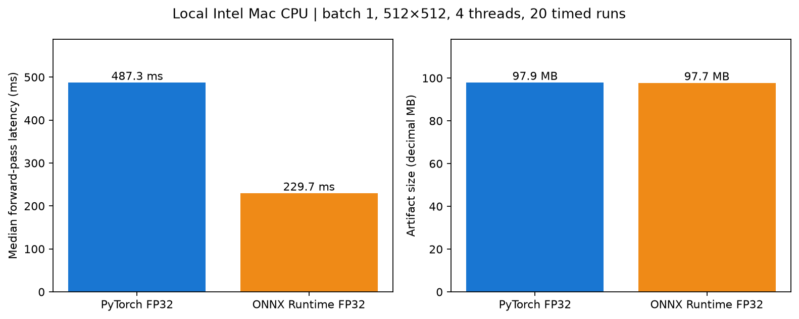

# FP32 ONNX export and CPU verification

The supplied U-Net checkpoint was exported with **ONNX opset 17**, checked with `onnx.checker`, and executed with ONNX Runtime's CPU provider. The local `m1_s1_fp32.onnx` binary is excluded from Git; [inference_config.json](inference_config.json) preserves its hash and prediction settings. INT8 quantisation has not been performed.

## Prediction contract

- Input `sar`: float32 array of shape **[1, 2, 512, 512]**, channels VV then VH, in dB before preprocessing.
- Clip VV to [-30, 5] and VH to [-42, -5]; subtract means [-10.394, -17.232] and divide by standard deviations [4.020, 4.691]. Replace NaNs with zero after normalisation, matching the current loader.
- Output `logits`: shape [1, 1, 512, 512]. Apply sigmoid, then `probability > 0.55` for the selected water mask. Sigmoid and preprocessing are outside the exported graph.
- Fixed batch size and spatial shape. Runtime users must retain the geospatial metadata separately when creating output rasters.

## Numerical verification

All **89 validation chips** were checked. Predeclared gates: probability `allclose` with absolute and relative tolerances 1e-4, no more than 0.01% mask disagreement, and PyTorch validation water IoU within 1e-6 of the recorded selected configuration.

| Check | Measured result |
|---|---:|
| Maximum absolute logit difference | 0.000341892 |
| Maximum absolute probability difference | 0.000040978 |
| Binary mask disagreements | 1 / 23,330,816 pixels |
| PyTorch water IoU | 0.689751673 |
| ONNX water IoU | 0.689751288 |
| Verification gates | Passed |

Mask agreement is measured across all input pixels; IoU excludes no-data labels. This verifies the FP32 export on validation data and does not establish Nigeria-specific performance or bitwise equality. No new test/Bolivia evaluation was used for this export.

## CPU benchmark

Hardware: Intel Core i7-8850H @ 2.60 GHz, macOS 15.8.3. PyTorch 2.2.2 and ONNX Runtime 1.23.2, four intra-op threads and one inter-op thread. Batch size one, first validation chip (`Ghana_5079_S1Hand.tif`), three warm-up runs per runtime and 20 timed runs per runtime, alternating execution order.

| Runtime | Median | p95 | Artifact size |
|---|---:|---:|---:|
| PyTorch FP32 | 487.3 ms | 619.8 ms | 97.9 MB |
| ONNX Runtime FP32 | 229.7 ms | 304.3 ms | 97.7 MB |

Approximately **2.12× lower median latency** in this local run. Artifact sizes are decimal MB. This is not a substantial model compression result.



Timing covers warm, in-memory forward passes only. It excludes session/model startup, imagery loading, preprocessing, sigmoid, mask creation, and network transfer. A single-chip benchmark on this laptop does not establish hosted latency, whole-pipeline throughput, or performance across all input scenes. Raw timings are in [latency_samples.csv](latency_samples.csv); hardware, environment, hashes and metrics are in [benchmark.json](benchmark.json).

## Reproduce

From the project root, install the tested export packages (Intel Mac / Python 3.12):

```bash
python -m pip install -c requirements/macos-intel.txt -r requirements/export.txt
python -m floodrisk.deploy.export \
  --root /path/to/sen1floods11 \
  --checkpoint best.pt \
  --config reports/m1-s1-kaggle-365653491/threshold_sweep/selected_config.json \
  --output reports/m1-s1-kaggle-365653491/onnx_fp32_rerun
```

Use a new output directory; the command preserves existing exports. The [review notebook](../../../notebooks/06_export/06-onnx-cpu-benchmark.ipynb) displays the saved measurements and figure. [ONNX Runtime documentation](https://onnxruntime.ai/docs/) describes the runtime; [quantisation documentation](https://onnxruntime.ai/docs/performance/model-optimizations/quantization.html) covers the separate future compression experiment.
