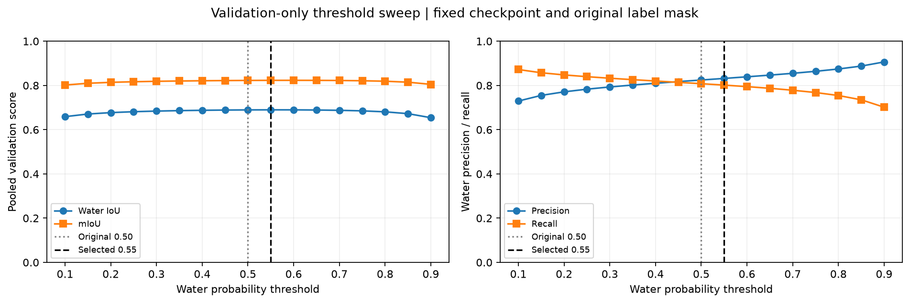

# Validation-selected threshold experiment

## Protocol fixed before inference

Evaluate thresholds 0.10 through 0.90 in steps of 0.05. Maximise pooled validation water IoU; ties favour proximity to 0.50, then the smaller threshold. Hold the checkpoint, preprocessing, and original label-only mask fixed. Select on the 89 validation chips, freeze the setting, then evaluate test and Bolivia once. No fine-grid search was performed.

[Selection configuration](selected_config.json) records the rule, grid, preprocessing, package versions, and checkpoint/split hashes. [Validation CSV](validation_thresholds.csv) contains all 17 thresholds. [Executed notebook](../../../notebooks/05_threshold/05-validation-threshold.ipynb) preserves the experiment. The selected configuration's held-out-status field records its state at selection time; subsequent results are in the separate [held-out report](held_out_evaluation.json).

## Validation result

Selected threshold: **0.55**. Water IoU changed from **0.689444** to **0.689752**: **+0.0307 percentage points**. Precision increased from **82.46%** to **83.18%**, while recall decreased from **80.79%** to **80.16%**. This is a small improvement in the chosen objective with reduced water recall.

The broad, nearly flat IoU curve suggests limited benefit from threshold adjustment alone. These model scores have not been established as calibrated probabilities.

## Frozen-threshold held-out evaluation

| Split | Threshold | Water IoU | mIoU |
|---|---:|---:|---:|
| Test | 0.50 | 0.697312 | 0.823634 |
| Test | 0.55 | 0.698459 | 0.824495 |
| Bolivia | 0.50 | 0.690794 | 0.808678 |
| Bolivia | 0.55 | 0.693550 | 0.810771 |

Test water IoU improves by approximately **0.115 percentage points** and Bolivia by **0.276 points**. Bolivia remains below the recorded Otsu water IoU of 0.697. This supports only a modest threshold benefit.

## Interpretation and limits

Threshold selection is a development decision, not retraining. Keep both configurations and their provenance visible. Validation was already used for checkpoint selection, and test/Bolivia had previously been inspected for diagnosis; these results are not equivalent to evaluation on a fresh untouched dataset. Do not use these held-out results to refine the threshold further. Independent Nigerian evaluation is still required.

The notebook checks that the 0.50 result reproduces the validation audit, predicted water counts and recall decrease monotonically with threshold, and the scored pixel count is constant. The held-out run uses the exact same checkpoint hash. The evaluation CLI accepts `--threshold 0.55`; its default remains 0.50 to preserve existing commands.
