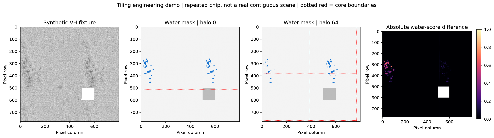

# Streaming scene tiling

The ONNX model accepts 512×512 inputs. The new `floodrisk.deploy.tiled` command processes arbitrary raster dimensions by reading one context window at a time and writing each output core once. No full-scene prediction array is allocated. Hashing is also streamed. ONNX working memory and raster-driver caches still use memory independently of these arrays.

## Context and assembly

With the default **64px halo**, the model reads 512×512 but only the central **384×384** output core is retained. Adjacent input windows overlap; retained output cores do not. There is no blending. `--halo 0` uses adjacent 512px cores. Smaller edge cores are cropped to the original image dimensions.

Real source intersections are read and padded explicitly in array space to preserve pixel alignment, including rotated grids. Outside-image padding and invalid input pixels use the normalised mean. Source-masked or non-finite pixels remain output no-data (mask 255; score -9999). Empty output cores are written as no-data without running inference. The original CRS, transform, shape and therefore bounds are retained.

Context margins are intended to reduce tile-edge effects, but are not a proven accuracy improvement. Changing context can change predictions. Edge padding and missing context can influence nearby valid pixels; a 64px halo does not guarantee seam-free results or cover the model's entire receptive field. Larger national scenes, throughput, and Nigeria-specific accuracy have not yet been validated.

## Engineering demonstration

The fixture repeats and crops the existing Mekong validation chip to **800×777**, then inserts a 100×100 missing-data square. This exercises partial tiles and no-data handling. It is **not a real contiguous satellite scene**; the inherited coordinates do not establish a real observed larger footprint.



Dotted red lines mark retained core boundaries. Grey denotes missing input/no-data. The right panel shows absolute sigmoid-score differences between the two context policies, not errors against ground truth.

| Property | Halo 0 | Halo 64 |
|---|---:|---:|
| Retained core size | 512 | 384 |
| Tiles processed | 4 | 9 |
| Valid output pixels | 611,600 | 611,600 |
| No-data output pixels | 10,000 | 10,000 |
| Predicted water pixels | 4,279 | 2,704 |

The context choices differ on 1,717 valid binary pixels. Mean absolute score difference is 0.00334, with a maximum of 0.82944. These are sensitivity measurements, not evidence that either context choice is more accurate. Results are in [comparison.json](comparison.json); each run has its own GeoTIFFs and provenance report under `halo_0/` or `halo_64/`.

## Run on a real prepared scene

```bash
python -m floodrisk.deploy.tiled \
  --input /path/to/sentinel1_vv_vh_db_scene.tif \
  --model reports/m1-s1-kaggle-365653491/onnx_fp32/m1_s1_fp32.onnx \
  --config reports/m1-s1-kaggle-365653491/onnx_fp32/inference_config.json \
  --output /path/to/new_scene_prediction \
  --halo 64
```

Inputs require a CRS and VV/VH in dB (defaults bands 1/2; explicit band indices are supported). This is water segmentation; permanent-water removal and flood-risk scoring are future work. Output rasters use compressed GeoTIFF blocks and BigTIFF when needed. Completed files are staged before publication; existing output directories are rejected. There is no tile-level resume/checkpoint system yet.

## Verification

Six tests pass across the original single-chip path and new tiling code. The new checks cover exact once-only output coverage on small, exact-size, and partial-edge scenes; rotated-grid placement using an independent pointwise coordinate echo; missing pixels; skipped empty cores; overwrite protection; and exact equality with the real single-chip model output at halo zero. The rotated-grid test caught a boundless-read problem, resolved by explicit pixel-space padding.

The demonstration checks output CRS, transform, shape and missing-pixel masks. The [executed notebook](../../../notebooks/08_tiling/08-scene-tiling.ipynb) reproduces the fixture, both context runs, measurements, and saved figure. It loads full arrays only for the small preview; the prediction command streams its windows.

```bash
python -m unittest discover -s tests -v
```
