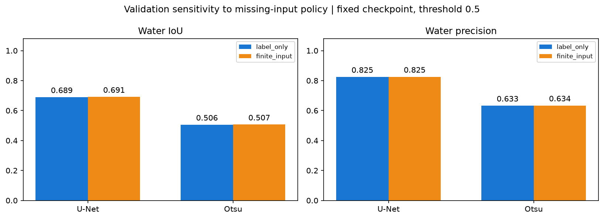
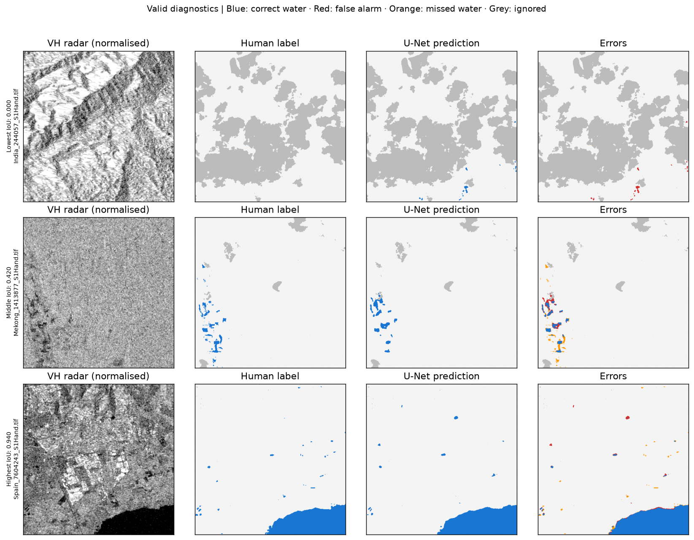

# Validation-set audit

The supplied checkpoint was evaluated on all **89 validation chips**, on CPU at threshold > 0.5. This is development data used during checkpoint selection; it is not an independent test. Source and execution outputs are preserved in the [notebook](../../../notebooks/04_validation/04-validation-audit.ipynb). The checkpoint/split hashes and environment are in [summary.json](summary.json); [per-chip counts](per_chip.csv) support the audit.

## Results

| Model / scoring policy | Water IoU | mIoU | Precision | Recall |
|---|---:|---:|---:|---:|
| U-Net / label-only | 0.6894 | 0.8227 | 0.8246 | 0.8079 |
| U-Net / finite radar inputs | 0.6912 | 0.8238 | 0.8254 | 0.8097 |
| Otsu / label-only | 0.5056 | 0.7109 | 0.6329 | 0.7155 |
| Otsu / finite radar inputs | 0.5067 | 0.7117 | 0.6340 | 0.7161 |

The original protocol excludes label -1. The separate sensitivity analysis additionally excludes any pixel with non-finite VV or VH, applying the identical mask to both methods. Changing the scored pixels is not a model improvement. Existing test and Bolivia benchmark results are unchanged.

## Findings

- Nine chips contain some non-finite input; none has entirely missing input. Missing inputs overlap 20,571 of 20,294,725 valid label pixels (approximately 0.10%).
- U-Net water IoU changes by approximately 0.18 percentage points when excluding those pixels. Missing inputs therefore have a small aggregate effect on this validation split under these policies.
- Original-policy U-Net precision is 82.46%, recall 80.79%. There are 384,470 false-positive and 429,830 missed-water pixels. Bolivia's lower precision does not reproduce as the same error balance on validation; avoid assuming one failure pattern applies everywhere.
- Re-evaluated water IoU is 0.689444, compared with the rounded logged best score of 0.6895. CPU versus CUDA mixed precision and package differences are plausible explanations for the small discrepancy, but the exact cause has not been established. It does not independently prove checkpoint epoch identity.

## Visual inspection

The examples use the lowest, middle-ranked, and highest per-chip IoU among chips with labelled water, with filename tie-breaking. They are diagnostic examples, not representative samples. Red denotes false water alarms, orange missed water, blue correctly predicted water, and grey ignored labels. The low-ranked India example has sparse labelled water; the middle Mekong example shows both missed patches and false alarms. These images do not establish a physical cause such as radar shadow without additional evidence.

## Decision

Retain the original benchmark protocol and checkpoint for now. Do not treat input masking alone as an accuracy breakthrough. A useful next development experiment is a validation-only threshold sweep: measure how requiring more or less water confidence trades precision against recall. Predefine its objective, record the selected threshold, and report any later held-out evaluation as a new model configuration. The validation score after selection will be optimistic, so final performance must remain a separate evaluation.
