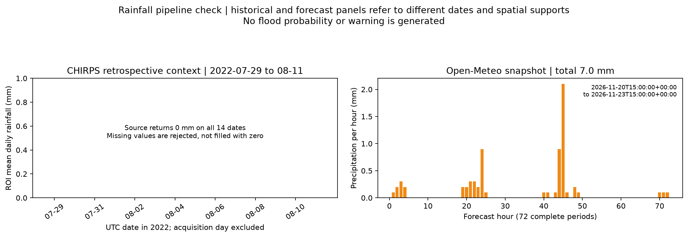

# Rainfall input pipeline: first Lagos snapshot

Historical rainfall and forecast ingestion are implemented, with strict time-window and missing-data validation. These are **inputs for future flood-risk modelling**, not trained risk scores or warnings.

## Historical context for the radar observation

[CHIRPS daily](https://developers.google.com/earth-engine/datasets/catalog/UCSB-CHG_CHIRPS_DAILY) provides gridded precipitation estimates in mm/day at 0.05° resolution. We calculate a mean over available native cells intersecting the radar ROI, not a 10m rainfall map, rain-gauge measurement, or LGA-wide estimate. Source: UCSB/Climate Hazards Center; Funk et al. (2015), [doi:10.1038/sdata.2015.66](https://doi.org/10.1038/sdata.2015.66).

The 2022-08-12 18:02 UTC radar observation is paired with **2022-07-29 through 2022-08-11**, excluding the acquisition day. Summaries use the last 1, 3, 7 and 14 complete UTC dates plus maximum daily rainfall. All source means are zero in this window. An independent server-side sum/min/max also returned zero from 14 images; the preceding fortnight returned a nonzero 7.1494mm ROI mean total. See [cross-check](historical_crosscheck.json). This supports correct extraction, not proof of zero rain everywhere in the area.

Final retrospective CHIRPS estimates were retrieved now; their dates do not prove they were available for a historical forecast. Production recent-rain inputs need a suitable low-latency source and latency handling. Missing or null rainfall is rejected, never changed to zero.

## Forecast snapshot

[Open-Meteo Forecast API](https://open-meteo.com/en/docs) was queried at requested coordinates **6.55°N, 3.45°E**. It returned a provider-selected grid point at **6.572935°N, 3.4005039°E**. This is spatially different from the historical ROI mean.

Retrieval: **2026-11-20 14:07:57 UTC**. Forecast window: **2026-11-20 15:00 to 2026-11-23 15:00 UTC**. It includes 72 complete future hours, avoiding the partially elapsed hour. Open-Meteo precipitation timestamps mark the total for the preceding hour; the first retained timestamp is 16:00, representing 15:00–16:00.

| Archived forecast feature | Value |
|---|---:|
| Next 24 hours | 2.9 mm |
| Next 48 hours | 6.6 mm |
| Next 72 hours | 7.0 mm |
| Maximum hourly precipitation | 2.1 mm |

These values describe **this archived snapshot**, not a continuously updated forecast or an LGA risk assessment. The response does not provide an explicit underlying model-run issue time; retrieval time is recorded and `model_run_issue_time` is null. `generationtime_ms` is an API computation duration, not an issue timestamp. Raw request parameters, returned coordinates, exact time bounds and features are in [summary.json](summary.json); the [raw forecast response](forecast_raw.json) is preserved.



The panels refer to different dates and different spatial supports. **Do not join the 2026 forecast to the 2022 satellite target.** Rainfall totals alone are not flood probabilities. This stage neither chooses a high-risk rain threshold nor issues alerts.

## Reproduce and verify

The [executed notebook](../../../notebooks/11_rainfall/11-rainfall-inputs.ipynb) reproduces features from the archived records and saves this figure. Raw historical data, CSV records and forecast payload are retained beside this report. To acquire a new snapshot, use a new output directory:

```bash
python -m floodrisk.acquire.rainfall \
  --project manifest-ivy-453612-b3 \
  --acquisition data/scenes/lagos_2022/acquisition.json \
  --output data/rainfall/lagos_new_snapshot
```

Twelve project tests pass. Rainfall-specific tests check historical day exclusion, rolling sums, future complete-hour selection, duplicate timestamps, missing horizons, and rejection of null, negative or non-finite precipitation. Snapshots are not scheduled automatically.

Next steps: establish suitable recent-rain availability, assemble multiple time-aligned events and non-events with independent labels, add susceptibility features, and evaluate risk models with time-based splits and historical forecasts available at issue time. One unlabelled water mask and one forecast cannot train or validate a flood-warning model.
